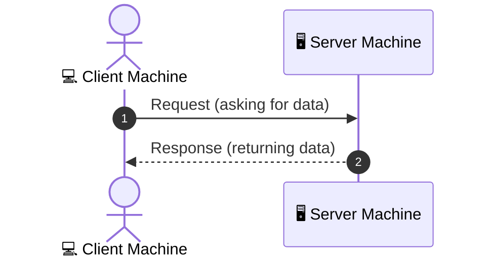
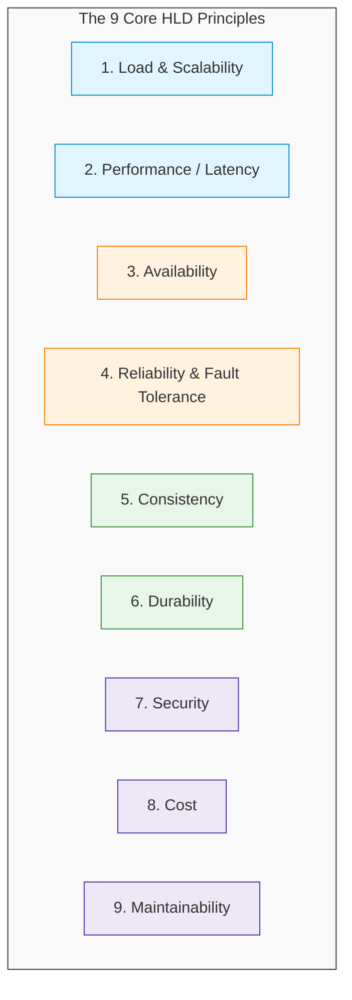

# System Design (HLD) Lecture 1: Introduction & Core Concepts

---

## 🗺️ Course Roadmap & Why HLD Matters

### Course Structure (30 Lectures Total)
* **Core Concepts (20 to 21 Lectures):** Networking, SQL/NoSQL DBs, queues/Kafka, APIs, monolith vs. distributed architectures, sharding, caching, industry buzzwords.
* **Live Case Studies (6 to 8 Lectures):** URL shortener, rate limiter, Shopify-like e-commerce app, video streaming app.

---

### Why HLD in the AI Era?
* **Code is automated:** AI can write code, so raw typing speed and syntax memorization are no longer unique selling points (USPs).
* **The real differentiator:** HLD sets you apart in interviews—it demonstrates computer science depth and the ability to make high-level engineering decisions.
* **Core Difference:** Unlike LeetCode problems, **system design has no single correct answer**.

---

## ⚖️ Core Rule: No Perfect Answer, Only Trade-offs

> **Main Idea:** You cannot make every parameter in a system "best". Optimizing one dimension inevitably impacts another.

### Real-World Analogy: Delhi to Patna Travel Options

| Travel Option | Time | Price | Comfort |
| :--- | :--- | :--- | :--- |
| ✈️ **Flight** | **Best** (least time) | **Worst** (highest price) | **Medium** (sitting) |
| 🛏️ **AC 3-Tier (AC3)** | **Medium** | **Medium** | **Best** (berth/bed to sleep) |
| 🚆 **Train General** | **Medium** (same as AC3) | **Best** (least price) | **Worst** |

#### Why this matters:
* **Speed vs. Cost:** Less time $\rightarrow$ higher price (Flight).
* **Cost vs. Comfort:** Lower price $\rightarrow$ lower comfort (General).
* **Compromise shifts:** Business class flight gives speed + comfort, but price jumps $5\times$.

```
                      ┌──────────────────────┐
                      │     THE CORE RULE    │
                      │  There are no        │
                      │  perfect answers,    │
                      │  only trade-offs.    │
                      └──────────┬───────────┘
                                 │
         ┌───────────────────────┴───────────────────────┐
         ▼                                               ▼
  Optimize Metric A                               Impacts Metric B
(e.g., Lower Latency)                          (e.g., Higher Cost / Complexity)
```

> **Interview Takeaway:** Never jump to give a solution immediately. Always ask the interviewer what their criteria, constraints, and priorities are first.

---

## 🌐 Basic Networking: How the Internet Works

* **Machine / Host:** Every digital device connected to the internet (laptop, phone, smartwatch, smart fridge, Google server, YouTube server).
* **The Interaction Model:** Machines interact primarily via two roles:
  * **Client:** The machine initiating the request for data.
  * **Server:** The machine processing the request and sending back the response.
  * *(Analogy from hospitality: Customer = Client, Waiter = Server).*

### Communication Flow



*Basic communication flow between two internet machines over request and response.*

#### Response Types
A server response is not always successful or immediate. It can be:
1. **Correct:** Exact data requested is returned.
2. **Wrong:** Incorrect data returned *(e.g., ordered egg, received sandwich)*.
3. **Delayed:** Response arrives after an unacceptable delay *(e.g., after 1 hour)*.
4. **Empty:** No response returned.
5. **Refusal:** Access or request denied *(e.g., "won't serve you")*.

---

## 🏗️ HLD vs. LLD (Machine Coding)

| Dimension | High Level Design (HLD) | Low Level Design (LLD / Machine Coding) |
| :--- | :--- | :--- |
| **Real-World Analogy** | **40-Story Apartment Blueprint**<br>(Planning lifts, windows, water system, gates, guard room) | **Room Interior Details**<br>(Tile design, window bar count, wall paint color) |
| **Scope** | Architecture design, system parts, APIs, DB selection, component interconnections, data flow. | Writing granular object-oriented code, class structures, and design patterns. |
| **Coding in Interview?** | ❌ **No coding needed** | ✅ **Yes, coding required** |

> **Doubt / Revisit:** Instructor mentioned LLD is becoming less critical in interviews nowadays compared to HLD, but skipped detailing why.

---

## 📐 The 9 HLD Principles



1. **Load & Scalability**
   * How much traffic/users the system can handle before breaking *(e.g., 100 to 1,000 users vs. 1 billion on Instagram)*.
   * **Scaling:** Expanding capacity through vertical scaling (bigger machine) or horizontal scaling (more machines).

2. **Performance / Latency**
   * The delay between a client making a request and receiving the server response *(e.g., target within 1s, 5s, 20s)*.

3. **Availability**
   * System remaining operational and reachable without crashing *(e.g., IRCTC Tatkal crashes = unavailable)*.
   * Measured in "nines" across 365 days: $99\%$, $99.9\%$, or $99.99\%$.
   * **Key Reality:** **$100\%$ availability is physically impossible** due to inevitable hardware and network failures.
   * **Impact:** $99\%$ availability translates to $\approx 3.65$ days of downtime per year (costing companies like Amazon billions of dollars).

4. **Reliability & Fault Tolerance**
   * **Reliability:** The system behaving correctly on every request.
     * *Example:* An ATM is up and gives ₹400 when ₹500 is requested $\rightarrow$ it is *available*, but *unreliable*.
   * **Fault Tolerance:** The system continuing to function even if individual machines fail.
     * *Example:* A cricket team of 11 continuing to play when 1 player gets injured.

5. **Consistency**
   * All users seeing the exact same up-to-date data at the same time.
   * *Example:* Pratyush transfers ₹100 to Divya $\rightarrow$ Pratyush's balance drops by ₹100 and Divya's balance increases by ₹100 instantaneously.

6. **Durability**
   * Committed/saved data remaining safe and intact despite power loss, crashes, or disasters.
   * *Example:* An Instagram outage must never cause a user's follower count to drop from 263k to 0.

7. **Security**
   * Safeguarding systems and user data against unauthorized access, leaks, and cyber attacks.

8. **Cost**
   * Engineering within realistic financial budgets (you cannot provision unlimited servers or high-end infrastructure everywhere).

9. **Maintainability**
   * Clean, well-structured architecture allowing other engineers to easily maintain, debug, and extend the system when original authors leave.

---

## 🔍 Trade-off in Action: Bank vs. Instagram

| Parameter | 🏦 Banking System | 📸 Instagram (Social Media) |
| :--- | :--- | :--- |
| **Primary Priority** | **Reliability & Consistency** over Availability | **Availability** over Strict Consistency |
| **Failure Scenario** | Displaying ₹500 balance instead of ₹2 Lakhs causes panic, legal trouble, and police FIRs. | Showing 80,000 views instead of 90,000 views temporarily causes no real-world harm. |
| **System Decision** | Better for the server (e.g., SBI) to **go down (unavailable)** than to display or process incorrect financial balances. | Better to **stay online and serve reels** even if view counters or like counts take time to sync. |

---

## 💡 Must Remember for Interview (From Video)

1. **No silver bullet:** HLD has no single correct answer—only trade-offs.
2. **Clarify before designing:** Never jump straight to solutions in an interview; clarify requirements and evaluate trade-offs first.
3. **Machine / Host:** Any internet-connected device (laptop, phone, server, smart fridge) is a host machine.
4. **Roles:** Clients request data; Servers process and deliver responses.
5. **Responses vary:** Server responses can be successful, wrong, delayed, empty, or an outright refusal.
6. **HLD vs. LLD:** HLD is architecture planning (like a 40-story building layout); LLD is granular code implementation.
7. **The 100% myth:** $100\%$ availability is impossible due to inevitable hardware/network failures.
8. **Availability $\ne$ Reliability:** Availability is the system being reachable; Reliability is returning correct data.
9. **Fault Tolerance:** System-level resilience where the service survives individual server crashes.
10. **Context dictates choice:** Banking platforms prioritize consistency over availability, while social media platforms prioritize availability over immediate consistency.

---

## 📑 Quick Revision Table

| Concept | One-Line Summary |
| :--- | :--- |
| **High Level Design (HLD)** | System-level architecture planning (components, DBs, APIs) before writing code. |
| **Low Level Design (LLD)** | Class-level code structure and implementation details. |
| **Client vs. Server** | Client requests data; Server processes and returns the response. |
| **Trade-off** | Optimizing one system metric by intentionally sacrificing another based on use case. |
| **Scalability** | System's capacity to handle growing user load (e.g., 100 to 1,000+ users). |
| **Latency** | Time delay between client request and server response. |
| **Availability** | Percentage of time a system remains operational and reachable. |
| **Reliability** | Guarantee that the system consistently produces correct results. |
| **Fault Tolerance** | Ability of a system to keep running even when individual servers fail. |
| **Consistency** | Guarantee that all users see the exact same updated data at the same time. |
| **Durability** | Guarantee that saved data persists through system crashes and power loss. |

---

> ### 📝 Interview Tips (Personal Notes, Not from Video)
> * **Clarify scope upfront:** Always start an HLD interview by asking clarifying questions to define functional and non-functional requirements before touching the whiteboard.
> * **Speak trade-offs aloud:** State your trade-offs explicitly (e.g., *"For this video streaming feature, I'm choosing High Availability over Immediate Consistency because..."*).
