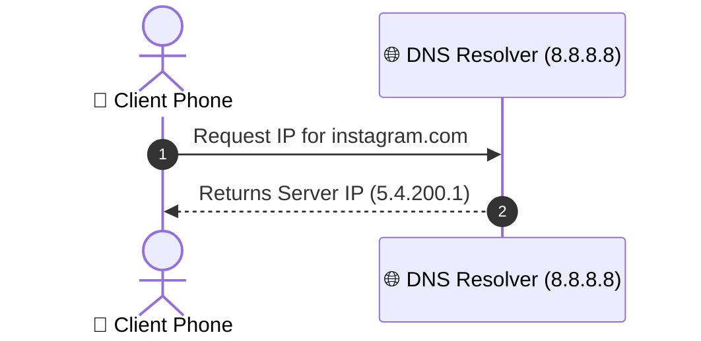
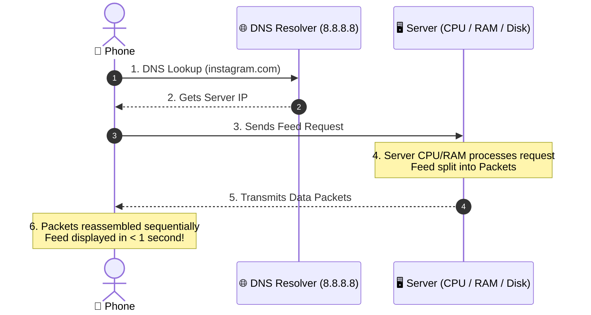

# System Design (HLD) Lecture 2: How an App Works Behind the Scenes

---

## 📱 Overview & Course Prerequisites

* **Prerequisites:** None. No complex prior networking knowledge needed—just basic world awareness.
* **Problem Statement:** What actually happens when you open Instagram or YouTube and your feed loads in less than 1 second?
* **Why This Matters:** Your phone only has 128 GB disk space—Instagram's data can't sit on your phone. A massive system executes behind the scenes in under 1 second.

---

## 🔄 Client & Server Model

* **Client:** The machine asking for data *(e.g., your phone)*.
* **Server:** The computer (laptop-like machine with CPU, RAM, disk) processing and returning data.
* **Request & Response:** Phone requests feed $\rightarrow$ Server responds with feed data.

---

## 🏷️ IP Address & IPv4

* **What It Is:** The virtual address assigned to every internet-connected device (phones, smartwatches, smart fridges, servers).
* **Why It's Needed:** Machines need "To" and "From" addresses to send data, just like writing a physical letter.

### Format & Exact Numbers

| Component | Specification |
| :--- | :--- |
| **Standard Format** | 4 parts separated by dots *(e.g., `10.7.8.200`)* |
| **Value Range per Slot** | 0 to 255 (256 possible values per slot) |
| **Full Address Range** | `0.0.0.0` to `255.255.255.255` |
| **Total IPv4 Pool** | **4.3 Billion** addresses |

> [!NOTE]
> **Doubt / Revisit:** Lecturer skipped the difference between private vs. public IP addresses, saying it's for a detailed networking course.

---

## 📖 Domain Name System (DNS)

* **What It Is:** The *"phone book of the internet"*.
* **Why It's Needed:** Humans struggle to remember IP numbers like `5.4.200.1` for every site (just like saving friend contacts by name instead of memorizing 10-digit phone numbers). Computers only understand IP addresses, while humans use names like `instagram.com`.
* **How It Works:** Phone settings store a special DNS Resolver IP *(e.g., `8.8.8.8`)*. Phone asks the DNS Resolver for the IP address of `instagram.com`, and DNS returns the machine IP.

### DNS Lookup Flow



*Flow of a client looking up a domain name to retrieve its underlying server IP address.*

---

## 📦 Packets, Speed of Light & Nearest Servers

### 1. What is a Packet?
Data isn't transferred as one giant file. Sending a 10-page book means the internet splits it into **10 separate 1-page packets**.

### 2. Reassembly
Packets travel across undersea fiber optic cables, wireless radio waves, and routers. They may arrive out of order *(e.g., page 5 before page 2)* and get reassembled in order on the client phone.

### 3. Physics & Latency
* **Speed of Light:** **3 Lakh km/sec**.
* **USA to Delhi Distance:** **14,000 km** $\rightarrow$ Request takes **$\sim$0.5 seconds** minimum.
* **Core Rule:** **You cannot beat physics with money.** Distance causes latency.

### 4. The Solution: Nearest Servers
Companies place servers locally *(e.g., Delhi or Mumbai instead of USA)* so local requests respond in nanoseconds instead of half a second.

---

## 💻 Server Anatomy: CPU, RAM & Disk

```
┌────────────────────────────────────────────────────────┐
│                     SERVER ANATOMY                     │
├────────────────────────────────────────────────────────┤
│  🧠 CPU       Processes requests & executes code       │
├────────────────────────────────────────────────────────┤
│  🪑 RAM       Study Desk (Fast, temporary workspace)   │
├────────────────────────────────────────────────────────┤
│  📚 DISK      Bookshelf (Slow, large persistent space) │
└────────────────────────────────────────────────────────┘
```

| Component | Analogy | Characteristics | Function |
| :--- | :--- | :--- | :--- |
| **CPU** | **Brain** | Processing core | Executes code and handles incoming requests. |
| **RAM** | **Study Desk** | Fast & temporary, limited space *(e.g., 16 GB)* | Workspace for active data. Data on the desk is instantly usable. |
| **Disk** | **Bookshelf** | Large capacity, slow access | Holds large amounts of data. When desk fills up, old books return here. |

> **Main Idea:** Data on the study desk (RAM) is instantly usable. If the desk gets full, old books go back to the bookshelf (Disk). This concept forms the basis of caching.

---

## 🚀 End-to-End Request Flow



*End-to-end flow of an app request from initial user action to rendering data on screen.*

---

## 💡 Must Remember for Interview (From Video)

1. **Hosts:** Every device connected to the internet is a host/machine identified by an IP address.
2. **IPv4 Pool:** IPv4 uses 4 octets ranging from 0 to 255, producing **$\sim$4.3 billion** unique addresses.
3. **DNS Role:** DNS acts as the internet's contact list, translating human domains (`instagram.com`) into IP addresses.
4. **Resolvers:** Default DNS resolvers use specialized IPs like `8.8.8.8`.
5. **Packets:** Data travels across the internet broken into smaller chunks called packets.
6. **Reordering:** Packets can take different paths and arrive out of order; the client reassembles them sequentially.
7. **Physical Bound:** Data speed is bounded by physics (speed of light: **3 Lakh km/sec**).
8. **Distance = Latency:** Physical distance adds unavoidable latency *(e.g., 14,000 km USA to Delhi route takes $\sim$0.5 sec)*.
9. **Nearest Server:** Placing servers close to users (nearest server) reduces latency from milliseconds/seconds down to nanoseconds.
10. **Storage Hierarchy:** RAM acts as fast temporary workspace (study desk); Disk acts as slow persistent storage (bookshelf).

---

## 📑 Quick Revision Table

| Concept | One-Line Summary |
| :--- | :--- |
| **IP Address (IPv4)** | Unique virtual address for an internet device (4 octets, $\sim$4.3 billion total). |
| **DNS (Domain Name System)** | Translates human-readable domain names into numerical machine IP addresses. |
| **Packet** | Small unit of data split for network transmission and reassembled at destination. |
| **Latency & Distance** | Network delay caused by physical distance (bounded by speed of light = 3 Lakh km/s). |
| **Nearest Server** | Deploying servers close to users to minimize network packet travel time. |
| **CPU vs. RAM vs. Disk** | CPU processes code; RAM is fast temporary workspace; Disk is slow persistent storage. |

---

> ### 📝 Interview Tips (Personal Notes, Not from Video)
> * **Geographic server placement:** When asked about latency in system design interviews, explicitly mention geographic server placement (edge servers/CDNs) to reduce network round-trip time (RTT).
> * **RAM vs. Disk justification:** Use the RAM vs. Disk distinction to justify why secondary cache layers (Redis/Memcached) sit in front of persistent databases.
