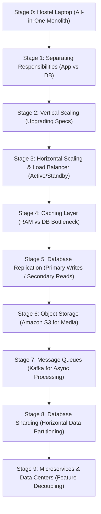
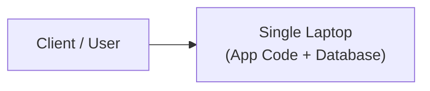
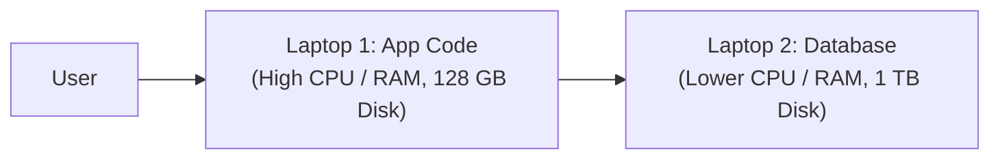
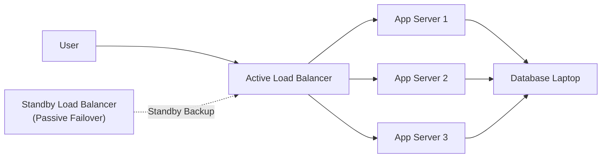
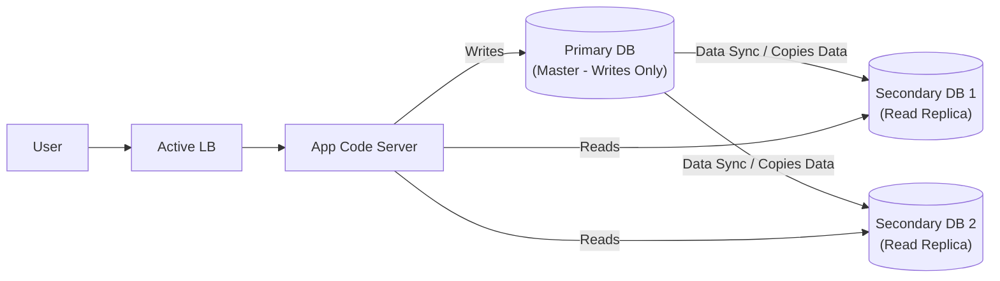
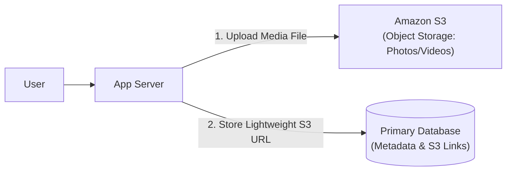
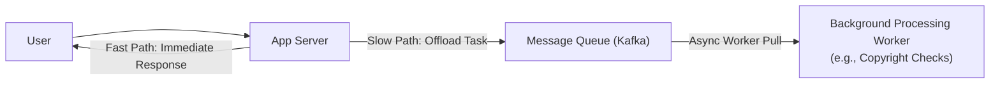
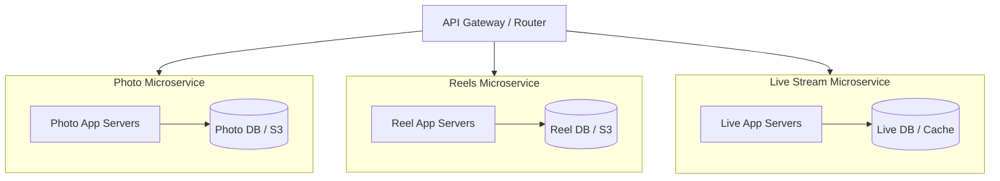

# System Design (HLD) Lecture 4: The Story of an App Growing Up

> **Executive Summary:**  
> An application starts on a hostel/personal laptop and evolves through 8 to 9 key architectural stages to scale into a production system like Instagram serving billions of users.  
> **Key Topics Covered:** Monolith setups, separation of concerns, vertical vs. horizontal scaling, load balancing, database replication, caching, object storage (S3), message queues (Kafka), database sharding, and microservices.

---

## 3 Core Concepts & Definitions

```
                     CORE FOUNDATIONAL PILLARS
┌───────────────────────┬─────────────────────────┬──────────────────────────┐
│      Bottleneck       │ Single Point of Failure │        Redundancy        │
│   (Slowest machine)   │    (1 Delivery Partner) │     (Car Stepney Tire)   │
└───────────────────────┴─────────────────────────┴──────────────────────────┘
```

### 1. Bottleneck
* **Highway Analogy:** An 8-lane highway constricts into a 1-lane construction zone before opening back out into 8 lanes. Traffic jams accumulate exclusively at the 1-lane section.
* **Definition:** A single slow part of a system that drags down the overall system performance.
* **Rule of Thumb:** *A team is only as good as its weakest member, and a factory is only as fast as its slowest machine.*

---

### 2. Single Point of Failure (SPOF)
* **Zomato Analogy:** 500 restaurants, 500 hungry customers, but only 1 delivery partner. If 1 restaurant closes or 1 customer uninstalls the app, the platform runs fine. But if that single delivery partner falls sick, the entire Zomato operation collapses.
* **Definition:** A critical component whose individual failure causes the entire system to crash.

---

### 3. Redundancy
* **Car Stepney Analogy:** A car operates on 4 active wheels but carries a 5th spare wheel (stepney) in the trunk. The spare performs no active work during normal driving; however, if a tire punctures, it immediately replaces the failed tire.
* **Definition:** Duplicate, backup components deployed to eliminate Single Points of Failure and ensure system continuity.

---

## The 9 Stages of App Evolution



---

### Stage 0: Hostel Laptop (Monolith on Single Machine)

* **Setup:** Runs application code and database (e.g., PostgreSQL, MongoDB) together on one personal laptop.
* **Function:** Stores user data (name, phone number, DOB), handles photo uploads, and serves feeds.


*Initial Stage 0 setup running application code and database together on a single machine.*

---

### Stage 1: Separating Responsibilities

* **Problem:** Application code and database compete for the same physical machine resources (CPU, RAM, Disk).
  * **Code:** Demands high CPU and RAM for computational logic.
  * **Database:** Demands high Disk space along with CPU/RAM for query execution.
* **Solution:** Split into 2 distinct, purpose-configured laptops:
  * **Laptop 1 (App Code):** High CPU & RAM, small disk (128 GB).
  * **Laptop 2 (Database):** Lower CPU & RAM, large disk (1 TB).


*Separation of application logic and database across two independent machines.*

---

### Stage 2: Vertical Scaling (Upgrading Hardware)

* **Problem:** High concurrent user traffic overwhelms Laptop 1 (8-core CPU, 16 GB RAM, 128 GB Disk).
* **Solution:** Upgrade the physical hardware specifications of Laptop 1 (e.g., to a 12-core CPU, 32 GB RAM, 1 TB Disk).
* **Pros:** Rapid 5-minute upgrade request on cloud providers (AWS, Google Cloud, Azure) with zero code modifications.
* **3 Major Limitations:**
  1. **Hardware Ceiling:** Physical upper boundary to maximum available RAM/CPU on a single machine.
  2. **Exponential Cost:** Costs grow exponentially rather than linearly (e.g., 16 GB RAM costs ₹20,000 → 32 GB RAM adds ₹6,000 → 64 GB RAM jumps to ₹2 Lakhs).
  3. **Single Point of Failure (SPOF):** If the single upgraded server encounters a hardware or OS failure, the entire application goes offline.

---

### Stage 3: Horizontal Scaling, Load Balancer & Failover

* **Solution:** Add multiple identical servers running the exact same application code (Laptop 1, Laptop 2, Laptop 3) managed by a **Load Balancer (LB)**.
* **Load Balancer Role:**
  * Routes traffic dynamically based on server load (e.g., 60%, 30%, 90% utilization).
  * Conducts periodic **Health Checks**. If a server stops responding (e.g., catches fire/crashes), the LB halts routing requests to it.
* **Cost Benefit:** Linear cost growth (e.g., purchasing an Asus laptop for ₹20,000 → 3 laptops cost ₹60,000 linearly).
* **Eliminating Load Balancer SPOF (Redundancy / Failover):**
  * A single Load Balancer is itself an SPOF.
  * Add a passive/standby Load Balancer that automatically takes over traffic if the primary LB fails.


*Horizontal scaling setup with active-standby load balancers and redundant application servers.*

---

### Stage 4: Database Bottleneck & Caching

* **Problem:** While application servers scale horizontally, the single Database machine gets choked by frequent repeat **READ** queries (e.g., users refreshing every 10 seconds to check photo like counts).
* **Solution (Caching):** Store frequently accessed read data (e.g., user bios, like counts) directly inside the fast RAM of application servers.
* **How it works:** Repeat read requests within short intervals are served immediately from RAM cache instead of hitting the Database disk.
* **Trade-off:** Cache staleness vs. update frequency. Re-syncing cache from DB every 1 to 2 minutes serves slightly stale data temporarily, but successfully shields the DB from massive read spikes.

---

### Stage 5: Database Replication (Primary & Secondary DBs)

* **Problem:** Heavy **WRITE** operations (account creation, photo uploads, comments) combined with heavy **READ** traffic exceed the throughput and storage bandwidth of a single DB.
* **Solution:** Split the database layer into Primary and Secondary nodes:
  * **Primary DB (Master):** Exclusively processes all **WRITE** operations.
  * **Secondary DBs (Replicas):** Multiple read-only databases processing all **READ** operations.
  * Primary DB periodically copies/syncs data over to the Secondary DBs (e.g., every 10 seconds or 1 minute).


*Database replication architecture separating write queries on Primary DB from read queries on Secondary DBs.*

---

### Stage 6: Object Storage (Amazon S3)

* **Problem:** Storing large binary media files (photos 100 MB – 500 MB, HD/4K videos) directly inside the Primary DB quickly exhausts disk capacity (hitting 1 TB, 2 TB, 5 TB limits).
* **Solution:** Introduce **Object Storage** (Amazon S3 / Simple Storage Service).
  * Upload actual media files to Amazon S3 (cost-effective at ~₹200/month for 10–20 GB, practically unlimited storage capacity).
  * Store only the lightweight S3 URL / file link (<10 KB – 100 KB) inside the Primary DB.



---

### Stage 7: Asynchronous Processing & Message Queues (Kafka)

* **Problem:** Synchronous execution of slow, non-essential operations (e.g., a 20-minute YouTube copyright check) blocks app servers and inflates client wait times (e.g., 22 minutes per user if processed sequentially).
* **Solution:** Partition incoming operations into instant vs. deferred workflows:
  * **Fast, essential tasks:** Immediate execution (file upload, initial metadata save ~2 mins).
  * **Slow, non-essential tasks:** Push task tokens to a **Message Queue** (e.g., Apache Kafka) for asynchronous, background processing during off-peak or lower-load cycles.



---

### Stage 8: Database Sharding

* **Problem:** Total database volume exceeds the physical storage or write-throughput ceiling of even a single high-end Primary DB machine.
* **Solution (Horizontal Sharding):** Horizontally partition data across multiple Primary DB nodes (Primary DB 1, Primary DB 2, Primary DB 3), mapping specific user segments/subsets to individual database shards.

```mermaid
flowchart TD
    App["App Servers / Sharding Logic"]
    App -->|Users 1 - 1M| Shard1[("Primary DB Shard 1")]
    App -->|Users 1M - 2M| Shard2[("Primary DB Shard 2")]
    App -->|Users 2M+| Shard3[("Primary DB Shard 3")]
```



---

### Stage 9: Microservices & Data Centers

* **Problem:** The platform expands into diverse, complex feature sets (Photos, Reels, Posts, Live Streams), making a monolithic single codebase fragile and hard to deploy/maintain.
* **Solution:** Decompose the monolith into independent **Microservices** (Photo Service, Reel Service, Post Service, Live Stream Service):
  * Each microservice maintains its own dedicated application servers, databases, caching layer, S3 storage, and sharding setup.
  * Supported by centralized monitoring, alerting, and multi-region data centers.



---

## Must Remember for Interview (From Video)

1. **Monolith to Split:** Monolith setups on a single machine work fine for Stage 0; app growth requires separating application code and database responsibilities.
2. **Hardware Profiling:** App servers require high CPU/RAM with minimal disk, whereas Database servers require high disk capacity with reliable I/O.
3. **Vertical Scaling Constraints:** Scaling up hardware is bounded by physical limits, exponential cost curves, and remaining an SPOF.
4. **Horizontal Scaling Efficiency:** Scaling out by adding identical commodity machines scales capacity at linear cost.
5. **Load Balancing & Health Checks:** Load balancers distribute requests across horizontal server pools and actively isolate dead instances via health checks.
6. **Eliminating LB SPOF:** Redundancy using passive-standby load balancers enables automated failover.
7. **RAM Caching:** Storing frequent read data in RAM shields underlying databases from read-heavy traffic spikes.
8. **DB Replication:** Separates heavy write operations (Primary DB) from distributed read operations (Secondary DB replicas).
9. **Object Storage Offloading:** Bulky media assets (photos, videos) belong in Object Storage (S3), storing only lightweight URL pointers in the DB.
10. **Asynchronous Task Queuing:** Time-consuming background operations (e.g., copyright validation) should be queued into message brokers (Kafka) without blocking synchronous request loops.
11. **Database Sharding:** Overcomes data scale limits by horizontally partitioning datasets across multiple Primary database shards.
12. **Microservice Isolation:** Decouples complex multi-feature systems by granting dedicated infrastructure stacks to each distinct functional domain.

---

## Quick Revision Table

| Concept | Problem It Solves | How It Works | Cost / Complexity Impact |
| :--- | :--- | :--- | :--- |
| **Bottleneck** | System slowdowns | Identifies slowest component constraining overall throughput | Guides targeted optimization |
| **Single Point of Failure (SPOF)** | Catastrophic system crashes | Identifies individual nodes whose failure takes down the system | Requires adding redundancy |
| **Redundancy** | Downtime during node failures | Deploys passive standby backup components (stepney model) | Increases hardware cost for higher availability |
| **Vertical Scaling** | Server resource exhaustion | Upgrades single machine CPU/RAM/Disk | Exponential cost growth with hard physical ceiling |
| **Horizontal Scaling** | Scaling limits of single server | Adds multiple identical servers behind a load balancer | Linear cost scaling, highly elastic |
| **Load Balancer** | Uneven traffic & server drops | Distributes requests and removes unhealthy instances | Introduces LB SPOF unless paired with standby LB |
| **Caching** | Database read congestion | Stores frequent read query results in fast memory (RAM) | Low latency reads; requires handling data staleness |
| **Database Replication** | Concurrent read + write choke | Writes route to Primary DB; reads route to Secondary DBs | Shields Primary DB; requires managing replication lag |
| **Object Storage (S3)** | Disk bloat from large media | Stores bulk files in S3; stores only lightweight URLs in DB | Drastically reduces DB disk storage & costs |
| **Message Queue (Kafka)** | Slow tasks blocking HTTP responses| Offloads long-running tasks for asynchronous worker processing | Decouples services; prevents client timeouts |
| **Database Sharding** | Single DB disk & write limits | Horizontally splits dataset across multiple Primary DB shards | Massively scales data volume; adds routing complexity |
| **Microservices** | Monolith code complexity & coupling| Breaks app into independently maintained, feature-specific stacks| High autonomy & scalability; higher ops complexity |

---

> [!TIP]
> ### Interview Tips (Mine, not from the video)
> * **Whiteboard Progression:** When asked to evolve a system design on a whiteboard, start from a simple 2-tier setup (Stage 1) and introduce load balancers, caching, S3, and replication step-by-step as you explain the trade-offs of growing scale.
> * **Highlight Trade-offs:** Explicitly highlight the trade-offs of DB replication (*replication lag between Primary and Secondary*) and caching (*cache invalidation strategies*) when pitching them as scale solutions.
