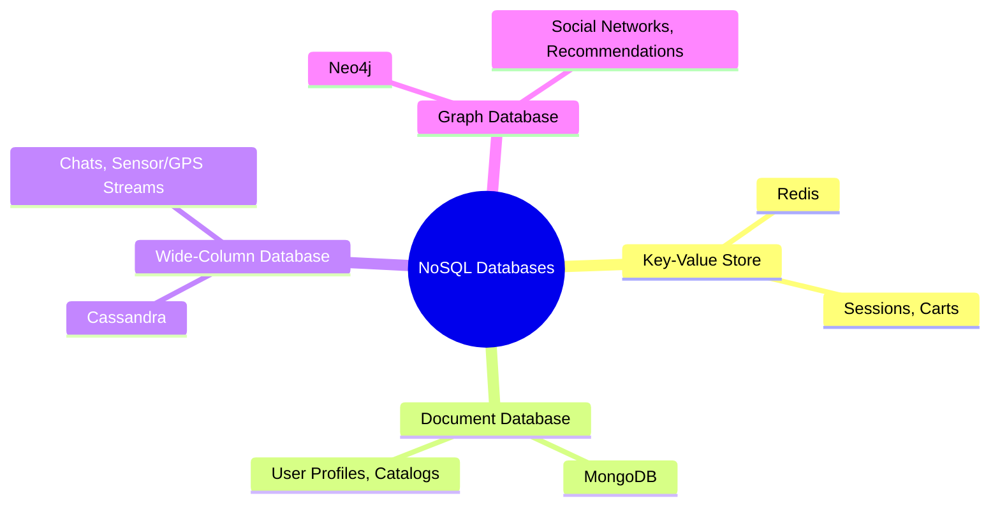
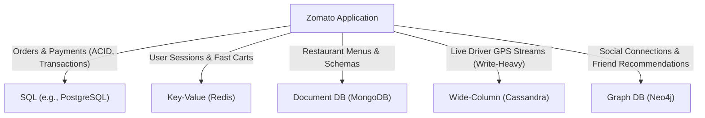

# System Design (HLD) Lecture 6: SQL vs NoSQL — What, When & Why

---

## 1. Why Database Choice Matters (Bank vs. Instagram)

### Real-World Scenarios

* **SBI Net Banking Scenario:** You transfer **₹5,000** to a friend. Two atomic steps occur:
  1. Deduct ₹5,000 from your account.
  2. Credit ₹5,000 to your friend's account.
  * **Failure Rule:** If ₹5,000 is deducted from your account but fails to credit your friend, SBI **must reverse** the ₹5,000 back to your account and mark the transaction as failed. Half-done transactions are strictly disallowed.

* **Instagram Scenario:** You tap "Like" on a post $\rightarrow$ your heart icon turns red, but the post's like counter stays at **100** instead of updating.
  * Nobody files an FIR over a missed like. Even if Instagram admits a DB glitch and doesn't fix it, nobody cares.

> [!IMPORTANT]
> **Core Takeaway:** There are **20+ famous databases** (and many lesser-known ones). No single database is "best" for everything—every database has pros and cons, so selection depends strictly on application requirements.

### 4 Core Operations of Any Database

| # | Operation | Type |
| :-: | :--- | :--- |
| **1** | **Store** | Write |
| **2** | **Find** | Read |
| **3** | **Update** | Write |
| **4** | **Delete** | Write |

---

## 2. SQL Databases (Relational Databases)

* **Definition:** Structured Query Language / Relational Database Management System (e.g., **PostgreSQL**). Enforces data storage strictly inside **tables** (a matrix of rows and columns).

### When SQL Fits vs. When It Fails

* **Good Fit Example — Student Marks:**
  * Clean, uniform schema with consistent columns across every row.
  * Columns: `Roll No` (unique), `Subject 1 Marks`, `Subject 2 Marks`.
  * Row `1010` $\rightarrow$ Subject 1: **80**, Subject 2: **60**. Next student $\rightarrow$ Subject 1: **60**, Subject 2: **20**.

* **Bad Fit Example — Flipkart Products Catalog:**
  * **iPhone** requires columns: `RAM` (8 GB), `CPU` (8 core), `Camera` (128 MP).
  * **Cotton Shirt** has no RAM/CPU/camera $\rightarrow$ introduces new columns `Length` (32 inch) and `Width` (40 inch), leaving the iPhone's cells empty or `0`.
  * **Dog Food Biscuit** introduces `Protein` (6g) and `Fat` (5g) $\rightarrow$ left empty/`0` for both the iPhone and the shirt.
  * **The Problem:** The table swells to **5,000 columns**, where an item like a cotton shirt utilizes only 2 columns and wastes the remaining 4,998 cells.

> [!TIP]
> **Key Rule:** Before choosing SQL, always verify whether your data naturally and cleanly fits into a tabular schema.

---

### Two Big Advantages of SQL

#### 1. Joins (Complex Queries Across Tables)
Combines multiple tables to evaluate complex, multi-condition queries.

* **School Scholarship Example:**
  * A school maintains 3 separate tables: *Sports Medals*, *Academic Marks*, and *Guardian Income*.
  * **Query:** Find students who are good at **football**, scored **greater than 85%**, and have a father/guardian annual income **less than ₹6 Lakhs**.

*Step-by-step filtering across three separate SQL tables using Joins to find eligible scholarship candidates.*

#### 2. ACID Properties (Strict Reliability)

| Property | Meaning & Rule | Real-World Example |
| :--- | :--- | :--- |
| **A — Atomicity** | **All or nothing.** | Full ₹5,000 transfer succeeds, or the entire transaction rolls back completely. |
| **C — Consistency** | **Database rules are never violated.** | If account balance cannot be negative and balance is **₹200**, an attempt to transfer **₹500** is automatically rejected. |
| **I — Isolation** | **Concurrent requests do not corrupt data** (prevents race conditions). | Account has **₹200**. Two users tap "Send ₹200" simultaneously on separate phones: with isolation, only one transaction passes, and the second fails with *"Not enough balance"*. |
| **D — Durability** | **Committed data persists permanently.** | Once committed, records survive crashes, power cuts, floods, or hardware fires. |

---

### Disadvantages of SQL

1. **Hard to split/scale horizontally:** Managing **100 tables** on a single machine is straightforward. Splitting them across multiple servers (**50 tables** on Machine 1, **50 tables** on Machine 2) makes executing a `JOIN` across distributed nodes (e.g., Sports + Marks on Machine 1 with Income on Machine 3) complex, slow, and expensive.
2. **Rigid schema:** Unsuitable for entities with wildly divergent attributes (e.g., Flipkart product catalog).

---

## 3. NoSQL Databases & The 4 Core Types

* **Definition:** Non-tabular databases (**NoSQL**, meaning not strictly structured relational tables). Engineered specifically for flexible data models, high speed, and seamless horizontal scaling.

---

### 1. Key-Value Store (Example: Redis)

* **Mechanism:** Operates like a locker room or HashMap. Data is stored against a unique `Key`, holding any corresponding `Value` (array, number, JSON, image).
* **Examples:**
  * `pratyush_cart` $\rightarrow$ `[iPhone, computer, socks]`
  * `pratyush_addresses` $\rightarrow$ `[address 1, address 2, address 3, address 4]`
  * Flipkart items $\rightarrow$ Key `iPhone` (8 GB RAM, 8-core CPU), Key `Shirt` (32 inch, 40 inch), Key `Biscuit` (6g protein, 5g fat).
* **Pros:** Blazing fast; effortlessly scales horizontally across 1, 3, or 10 machines because keys have zero relational coupling.
* **Cons:** No support for complex queries. You can request *"contents of Locker #7"*, but you **cannot** query *"which of the 100 lockers contains a red shirt?"*.

---

### 2. Document Database (Example: MongoDB)

* **Mechanism:** Encapsulates an entity's complete dataset in a single self-contained document (JSON-like format). Different documents within the same collection can have distinct fields.
* **Examples:**
  * **Student records:** Student 1 has `{name, roll_no, math, science, height, weight}`. Student 2 (no science) has `{name, roll_no, math, height, weight}` (omits the `science` key entirely).
  * **User profile:** Combines cart items, delivery addresses, and payment details inside a single `Pratyush` document instead of scattering across separate tables.
* **Pros:** Fetches an entire comprehensive profile or product catalog item in **a single read operation**.

---

### 3. Wide-Column Database (Example: Cassandra DB)

* **Mechanism:** Acts like a continuous register/ledger where each entity owns a row/page, and incoming entries are appended continuously.
* **Examples:**
  * **WhatsApp chats:** Individual dedicated pages for *Rahul & Priya*, *Priya & Aman*, and *Mohit & Suri*, where new messages continuously append.
  * **Write-heavy streams:** Uber drivers broadcasting GPS telemetry every **5 seconds**, real-time server logs every second, or highway speed camera logs.
* **Pros:** Highly optimized for **massive volumes of continuous writes** (write-heavy architectures).

---

### 4. Graph Database (Example: Neo4j)

* **Mechanism:** Models and persists data directly as **Nodes** (entities) and **Edges** (relationships).
* **Examples:**
  * **LinkedIn:** Pratyush $\rightarrow$ connected to $\rightarrow$ Divya (**1st connection**) $\rightarrow$ connected to $\rightarrow$ Aman (**2nd connection**), with edge metadata like *"Works at Akamai"*.
  * **Facebook:** Sita $\rightarrow$ Geeta $\rightarrow$ Babita, powering the *"People You May Know"* engine.
  * **Netflix:** Recommending titles based on viewers with overlapping taste nodes.
* **Pros:** Unmatched speed and efficiency for highly interconnected data, multi-hop lookups, and recommendation engines.

---

## 4. BASE Properties (NoSQL Guarantees)

Instead of strict ACID guarantees, NoSQL operates on the **BASE** model:

* **BA — Basically Available:** The cluster remains operational even when individual nodes fail (analogous to a car continuing to run on 3 tires after 1 punctures, until the engine stops).
* **S — Soft State:** Replicas may temporarily fall out of sync (e.g., you see **100 likes** on an Instagram post while another user sees **102 likes** at the same instant).
* **E — Eventually Consistent:** All distributed nodes converge and synchronize over time (e.g., after a brief window or 1–2 hours).

> [!WARNING]
> **Trade-off Rule:** You cannot use Eventual Consistency for UPI payments (you cannot tell a merchant *"your ₹5,000 will reflect in 2–3 hours"*), but it works perfectly for social metrics like Instagram likes and views.

---

## 5. SQL vs. NoSQL Comparison

| Feature | SQL (Relational) | NoSQL |
| :--- | :--- | :--- |
| **Data Storage** | Structured tables (matrix of rows & columns). | Flexible models: Key-Value, Document, Wide-Column, Graph. |
| **Complex Queries** | **Easy** (native Joins across multiple tables). | **Difficult / Limited** (no native cross-entity joins). |
| **Scaling** | Hard to partition across machines (favors vertical scaling). | **Easy** to scale horizontally (decoupled records). |
| **Core Guarantees** | **ACID** (strict consistency & atomicity). | **BASE** (high availability & eventual consistency). |
| **Prominent Examples** | PostgreSQL | Redis, MongoDB, Cassandra, Neo4j |

> [!NOTE]
> NoSQL is not magically faster—it achieves speed and horizontal scalability by **deliberately trading off** strict ACID consistency, multi-table joins, and rigid schemas.

---

## 6. Real-World Hybrid Architecture: Designing Zomato

Modern production systems rarely rely on a single database. An application like **Zomato** utilizes a **polyglot persistence model**, orchestrating **5 specialized databases**:

*How a single application routes different workloads to specialized SQL and NoSQL databases.*

---

## 7. Must Remember for Interview (From Video)

1. **No Database is Universally "Best":** Every database selection involves trade-offs between schema rigidity, query flexibility, speed, consistency, and scalability.
2. **4 Core Operations:** Every database supports Store (Write), Find (Read), Update (Write), and Delete (Write).
3. **When to Choose SQL:** When data maps cleanly into tables, relies heavily on **complex queries (Joins)**, or requires absolute **ACID** transaction integrity (banking, billing, order processing).
4. **ACID Fundamentals:** Atomicity (all-or-nothing), Consistency (rule enforcement), Isolation (no concurrency race conditions), Durability (persisted on disk).
5. **SQL Scaling Limit:** Scaling horizontally becomes prohibitive once interconnected tables must be partitioned across different servers.
6. **4 NoSQL Flavors:** Key-Value (Redis), Document (MongoDB), Wide-Column (Cassandra), and Graph (Neo4j).
7. **Key-Value Specialty:** Unbeatable speed for direct key lookups (session states, active carts), but incapable of multi-attribute field searches.
8. **Document DB Specialty:** Bundles full entity details into one JSON-style document, fetching complete profiles or catalogs in a single read.
9. **Wide-Column & Graph Specialties:** Wide-Column absorbs massive write streams (chats, telemetry, high-frequency GPS); Graph traverses deep multi-hop relationship trees (social graphs, recommendations).
10. **BASE Model:** NoSQL trades ACID for BASE (Basically Available, Soft State, Eventually Consistent) to optimize for uptime and distributed horizontal scale.
11. **Polyglot / Hybrid Architecture:** Production systems combine relational and multiple specialized NoSQL stores based on individual service workloads.

---

## 8. Quick Revision Table

| Concept | One-Line Summary |
| :--- | :--- |
| **SQL Database** | Relational DB storing structured data in tables with Joins and strict ACID guarantees. |
| **Joins** | SQL mechanism combining multiple tables to execute multi-condition cross-entity queries. |
| **ACID Properties** | Atomicity, Consistency, Isolation, Durability—ensuring error-free, atomic transactions. |
| **NoSQL Database** | Non-tabular stores built for flexible schemas, rapid reads/writes, and easy horizontal scaling. |
| **Key-Value Store (Redis)** | Hash-mapped storage delivering high-throughput single-key lookups (sessions, active carts). |
| **Document DB (MongoDB)** | Self-contained JSON-like stores consolidating varied entity data into single-read documents. |
| **Wide-Column DB (Cassandra)** | Append-optimized row/page storage engineered for high-velocity write streams (GPS, chats, logs). |
| **Graph DB (Neo4j)** | Node-edge stores purpose-built for relationship traversal (social networks, recommendations). |
| **BASE Properties** | Basically Available, Soft State, Eventually Consistent—prioritizes availability over instant consistency. |

---

> [!TIP]
> ### Interview Tips (Mine, Not From The Video)
> 
> * **Evaluate 3 Questions First:** Before recommending a database in an HLD interview, clarify:
>   1. *How structured is the data?*
>   2. *Do we need multi-table joins?*
>   3. *Can the business tolerate eventual consistency, or do we strictly need ACID transactions?*
> * **Propose a Hybrid Architecture:** Mentioning a **hybrid/polyglot database architecture** (such as PostgreSQL for payments/orders, Redis for sessions/caching, and Cassandra for telemetry/logs) immediately demonstrates senior-level system design maturity.
