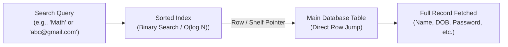
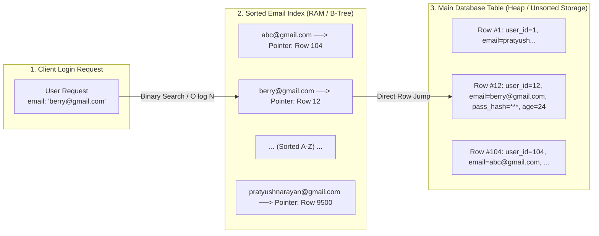
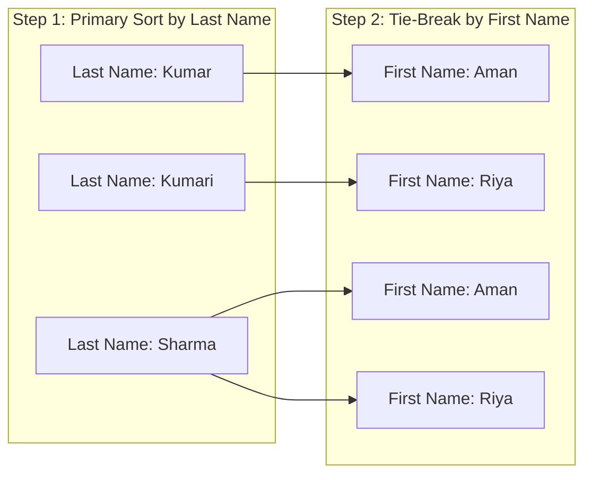
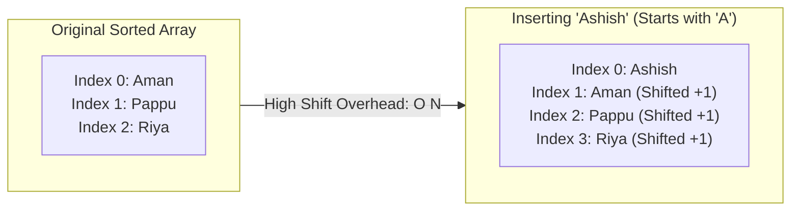
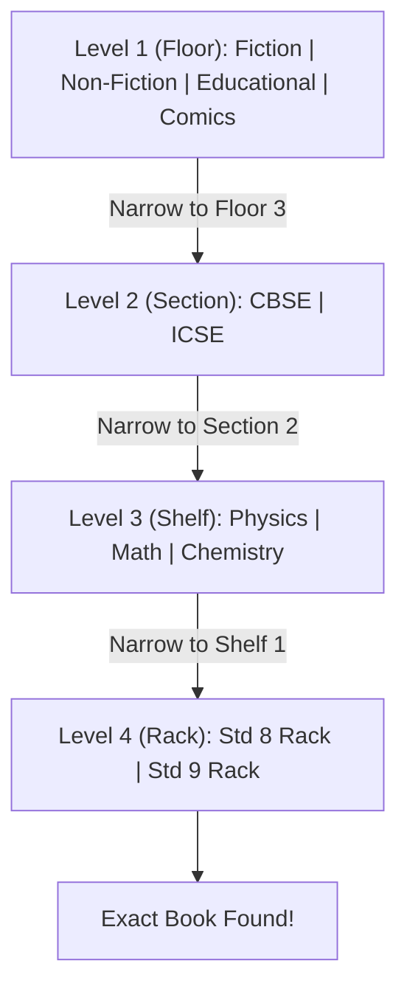
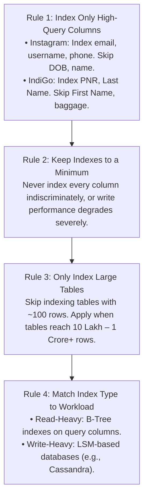

# System Design (HLD) Episode 7: Database Indexing — What, Types, How It Works & When to Use

---

## 1. Why Database Indexing Matters (The Slow Search Problem)

At its core, a database primarily handles two fundamental operations: **finding (reading)** data and **updating (writing)** data. When data grows massive, finding records becomes a critical performance bottleneck.

### Real-World Scenarios

* **Instagram Login Scenario:**
  * When you log in using your email/username and password, Instagram queries its user table to locate your email and verify your credentials.
  * **With 10, 100, or 1,000 users:** Scanning rows one by one (Linear Search) is fast and imperceptible.
  * **With 100 Crore users:** Performing a sequential scan on every single login attempt brings the database to a complete halt.

* **Library Analogy:**
  * **Small Library (10 books on 1 shelf):** Scanning manually book-by-book to find *Harry Potter* takes seconds.
  * **Massive Library (10 Crore books):** Spread across multiple floors, sections, and 100+ shelves per section; searching book-by-book is physically impossible.

> [!IMPORTANT]
> **The Solution & Trade-off:**
> **Database Indexing** solves slow lookups in large databases. However, it introduces significant trade-offs—you must know *when*, *where*, and *how* to apply it.

---

## 2. What is an Index? (How It Works)

An **Index** is a separate, **sorted lookup structure** built on a specific column that points directly to the exact location (row/shelf) of the data in the primary database table.

---

### Example 1: Library Subject Index

Suppose a library stores books across **10 subjects** on shelves in random order:
`Physics (Shelf 1)`, `Geography (Shelf 2)`, `Chemistry (Shelf 3)`, `English (Shelf 4)`, `Math (Shelf 5)`, `History (Shelf 6)`.

Because visitors search by **Subject Name** (and do not know the shelf number beforehand), you build a separate lookup table sorted alphabetically by **Subject Name**:

| Sorted Subject (Query Key) | Shelf Number (Pointer) |
| :--- | :--- |
| **Chemistry** | Shelf 3 |
| **English** | Shelf 4 |
| **Geography** | Shelf 2 |
| **History** | Shelf 6 |
| **Math** | Shelf 5 |
| **Physics** | Shelf 1 |

* **How Search Speeds Up:**
  * Because the index is sorted alphabetically, you apply **Binary Search** (from DSA).
  * **Lookup Path for *Math*:**
    1. Check middle element $\rightarrow$ `History`
    2. *Math* comes after `History` (alphabetically) $\rightarrow$ search lower half
    3. Check middle element $\rightarrow$ `Physics`
    4. *Math* comes before `Physics` $\rightarrow$ match found at **Shelf 5**
  * **Result:** Reached in **2–4 steps** instead of sequentially scanning every shelf.

---

### Example 2: Instagram Email Index

1. **Build Sorted Index:** Copy all user emails into a separate sorted index alongside their exact **Row Number** in the main database (`abc@gmail.com`, `berry@gmail.com`, ..., `pratyushnarayan@gmail.com`).
2. **Fast Binary Search:** When a user logs in, execute **Binary Search** on the Email Index $\rightarrow$ retrieve the exact row pointer (`Row #12`).
3. **Direct Table Access:** Jump directly to that row in the main table to verify the password and fetch profile attributes (name, DOB, age, etc.).

---

## 3. Types of Indexes

### 1. Primary Index

* Built on the table's **Primary Key**—a column guaranteed to be unique for every single row.
* **Examples:** College Roll Number (`CS01`, `CS02`, `CS03`, `CS05`), Instagram User ID, Aadhaar Number, Phone Number.
* *Why it's needed:* Real-world fields like Student Name can have duplicates (e.g., multiple students named "Suraj"), so the Primary Key uniquely identifies each record.

#### Clustered vs. Non-Clustered Index (Common Interview Question)

| Dimension | Clustered Index | Non-Clustered Index |
| :--- | :--- | :--- |
| **Physical Storage** | Main table data rows are **physically sorted** in the exact same order as the index key. | Main table data rows remain **unsorted** in arbitrary physical order. |
| **Order Example** | Main table rows are physically placed in order: `CS01`, `CS02`, `CS03`, `CS04`. | The index is sorted (e.g., emails sorted A–Z), while table rows sit in random heap order (e.g., Pratyush's row above Akhil's row). |
| **Pointers** | Leaf nodes contain the **actual data rows**. | Leaf nodes contain **pointers** referencing the row locations in the main table. |

---

### 2. Secondary Index

* Built on a **non-primary-key column** that may contain duplicate values.
* **Example:** Creating an index sorted by Student Name: `Aman`, `Ayan`, `Binita`, `Chris`, `Dog`, even if two students share the same name ("Aman").

---

### 3. Composite Index

* Built on **two or more columns combined** in a specific priority order.
* **Example (`Last Name` + `First Name`):**
  * Given students: *Riya Sharma*, *Aman Sharma*, *Riya Kumari*, and *Aman Kumar*.

1. **First sorted by Last Name:** `Kumar`, `Kumari`, `Sharma`, `Sharma`.
2. **Within the same Last Name, sorted by First Name:**
   * `Kumar` $\rightarrow$ `Aman`
   * `Kumari` $\rightarrow$ `Riya`
   * `Sharma` $\rightarrow$ `Aman`
   * `Sharma` $\rightarrow$ `Riya`

* **Query Benefit:** Lets you efficiently query all students with last name `Sharma`, or pinpoint `Aman Sharma` directly.

---

## 4. Data Structures Used for Indexing

### Why NOT a Sorted Array?

If you store an index in a plain sorted array—say `[Aman, Pappu, Riya]`—reads are fast via Binary Search, but **writes/inserts are terrible**:

* Adding `Rajeev` requires shifting `Riya` to the right.
* Adding `Ashish` (starts with A) requires shifting **every single element** (`Aman`, `Pappu`, `Rajeev`, `Riya`) one step right.

To solve this, databases use specialized tree and log data structures:

---

### 1. B-Tree / B+ Tree (Used in SQL / PostgreSQL)

A multi-level hierarchical tree structure that keeps searches fast and updates localized.

*Multi-level B-Tree narrowing 40 Lakh books down to a single book in 4–6 steps.*

* **Library Hierarchy Breakdown (40 Lakh Books Total):**
  * **Level 1 (Category $\rightarrow$ Floor):** `Fiction (10L, Fl.1)`, `Non-Fiction (10L, Fl.2)`, `Educational (10L, Fl.3)`, `Comics (10L, Fl.4)`
  * **Level 2 (Board $\rightarrow$ Section):** `CBSE (5L, Sec.1)`, `ICSE (5L, Sec.2)`
  * **Level 3 (Subject $\rightarrow$ Shelf):** `Physics (1L, Sh.1)`, `Math (2L, Sh.2)`, `Chemistry (2L, Sh.3)`
  * **Level 4 (Class $\rightarrow$ Rack):** `Std 8 Rack`, `Std 9 Rack` $\rightarrow$ **Exact Book Found!**

* **Performance Characteristics:**
  * **Fast Reads:** Searching for *Class 9 Physics ICSE* eliminates 30 Lakh books at Level 1, 5 Lakh at Level 2, and 4 Lakh at Level 3—finding the exact book in **4–6 steps** regardless of database size.
  * **Localized Writes:** Adding a new *Class 8 Physics ICSE* book only updates the `Std 8 Rack` leaf node at Level 4. Upper levels (Floors, Sections, Shelves) do not change at all.

---

### 2. LSM Tree — Log-Structured Merge (Used in Cassandra)

For **write-heavy** databases, updating a B-Tree on disk on every single write is still too slow. Cassandra uses **LSM** instead:

*Write and background compaction pipeline in a Log-Structured Merge (LSM) index.*

#### Step-by-Step Workflow

1. **Rough Copy (RAM):**
   * Suppose the Main Index on disk has: `R2 -> Mumbai`, `R5 -> Delhi`, `R9 -> Pune`.
   * When updates arrive (`R5 -> Patna`, `R7 -> Kolkata`, `R2 -> Left school [X]`), Cassandra writes them straight to a fast buffer in **RAM** without touching the Main Index on disk.
2. **Temporary Index:**
   * When RAM fills up, it flushes those sorted entries (`R2 -> X`, `R5 -> Patna`, `R7 -> Kolkata`) into a `Temporary Index 1` on disk and clears RAM.
   * The next incoming write (`R1 -> Noida`) goes into the fresh RAM buffer.
3. **Read Priority (Newest to Oldest):**
   * *Query `R1`:* Found immediately in **RAM** (`Noida`).
   * *Query `R5`:* Not in RAM $\rightarrow$ found in **Temporary Index** (`Patna`), safely ignoring the outdated `Delhi` entry in the Main Index.
   * *Query `R9`:* Not in RAM $\rightarrow$ not in Temporary Index $\rightarrow$ found in **Main Index** (`Pune`).
4. **Background Merge:**
   * During low-traffic or idle windows (e.g., once a week or every 1–2 days), Temporary Indexes are merged with the Main Index and outdated entries are permanently discarded.

---

## 5. When to Use Indexing (Trade-offs & Rules)

### Core Trade-off Comparison

| Pros of Indexing (Advantages) | Cons of Indexing (Overhead) |
| :--- | :--- |
| **Fast Reads:** Logarithmic lookup (`Binary Search` / `B-Tree`) instead of full table scans. | **Slower Writes:** Every insert, update, or delete in the main DB must also update every index on that table. |
| **Targeted Filtering:** Instant lookups on key search fields. | **Extra Storage:** Each index consumes additional disk space. |

---

### 4 Golden Rules for Indexing

1. **Index only high-query columns:**
   * *Instagram:* Index `email`, `username`, and `phone number` (used frequently during authentication) — do **not** index `DOB` or `name`.
   * *IndiGo Airlines:* Index `PNR` and `Last Name` (used to retrieve passenger reservations) — do **not** index `First Name` or baggage details.
2. **Keep indexes to a minimum:** Never blindly index every column (`name`, `email`, `DOB`, `age`), as write throughput will degrade sharply.
3. **Only index large tables:** Avoid over-engineering indexing on small tables (**~100 rows**); implement indexing when datasets reach **10 Lakh to 1 Crore+ rows**.
4. **Match index architecture to workload:**
   * **Read-heavy workload:** Use **B-Tree** indexes on frequent query columns.
   * **Write-heavy workload:** Use **LSM (Log-Structured Merge)** databases like **Cassandra** (accepting multi-tier read traversal across RAM, Temporary, and Main indexes in exchange for blazing-fast write performance).

---

## 6. Must Remember for Interviews (From Video)

> [!IMPORTANT]
> 1. **Core Problem:** Indexing prevents slow linear scans when tables scale to millions/crores of records by maintaining a separate **sorted lookup structure** with pointers to actual rows.
> 2. **Targeted Design:** Always index the column utilized in your **search queries** (e.g., Subject Name in a library, Email/Username in Instagram, PNR + Last Name in IndiGo).
> 3. **The 3 Index Types:**
>    * **Primary Index:** Built on unique Primary Keys.
>    * **Secondary Index:** Built on non-unique columns.
>    * **Composite Index:** Multi-column index sorted hierarchically (e.g., `Last Name` then `First Name`).
> 4. **Clustered vs. Non-Clustered:** Clustered means the main database table itself is physically sorted by the index key; Non-Clustered means only the index is sorted while table rows remain in arbitrary order.
> 5. **Why Sorted Arrays Fail:** Inserting an element near the front requires shifting all subsequent elements ($O(N)$ write overhead).
> 6. **B-Trees / B+ Trees:** Used in PostgreSQL/SQL; enable fast multi-level navigation (Floor $\rightarrow$ Section $\rightarrow$ Shelf $\rightarrow$ Rack) with localized leaf node updates.
> 7. **LSM (Log-Structured Merge):** Used in Cassandra; writes buffer in RAM ("rough copy"), flush into sorted temporary indexes, resolve reads hierarchically (`RAM -> Temp -> Main`), and merge in the background during idle periods.
> 8. **Fundamental Trade-off:** Indexing accelerates **reads** at the direct cost of **slower writes** and **extra disk storage**—never index every column, and avoid indexing tiny tables (e.g., 100 rows).

---

## 7. Quick Revision Table

| Concept | Architectural Category | One-Line Summary |
| :--- | :--- | :--- |
| **Database Index** | Core Mechanism | Separate sorted lookup structure pointing to exact row locations for fast reads. |
| **Primary Index** | Index Type | Index built on a table's unique Primary Key (e.g., Roll No, User ID). |
| **Clustered Index** | Index Type | Index where the main table's rows are also physically sorted in index order. |
| **Non-Clustered Index** | Index Type | Sorted index pointing to main table rows that are stored in unsorted order. |
| **Secondary Index** | Index Type | Index built on a non-primary-key column (may contain duplicate values). |
| **Composite Index** | Index Type | Multi-column index sorted sequentially by two or more fields (e.g., Last Name + First Name). |
| **B-Tree / B+ Tree** | Data Structure | Multi-level tree index (used in SQL/PostgreSQL) offering fast reads and localized leaf updates. |
| **LSM (Log-Structured Merge)** | Data Structure | Write-optimized indexing (used in Cassandra) using RAM buffers, temporary indexes, and periodic merges. |

---

> ### Interview Tips (Mine, Not From Video)
>
> * In a system design interview, never just state *"I will add an index to make it fast."* Explicitly specify the **exact column(s)** (e.g., *"I'll create a composite index on `(user_id, created_at)`"*) and proactively highlight the **write-amplification and storage trade-off**.
> * If an interviewer asks about **Composite Index column order**, recall the **leftmost prefix rule**: an index on `(last_name, first_name)` accelerates queries filtering by `last_name` alone or `(last_name + first_name)`, but cannot be used efficiently if the query filters solely by `first_name`.
