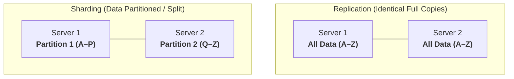
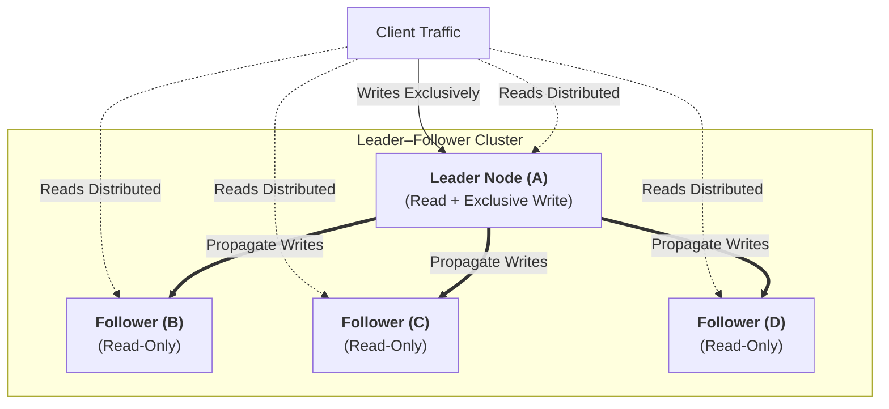
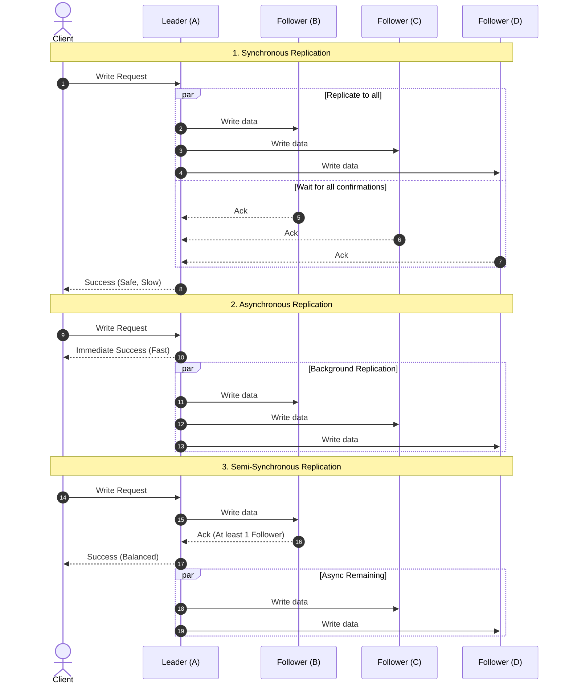
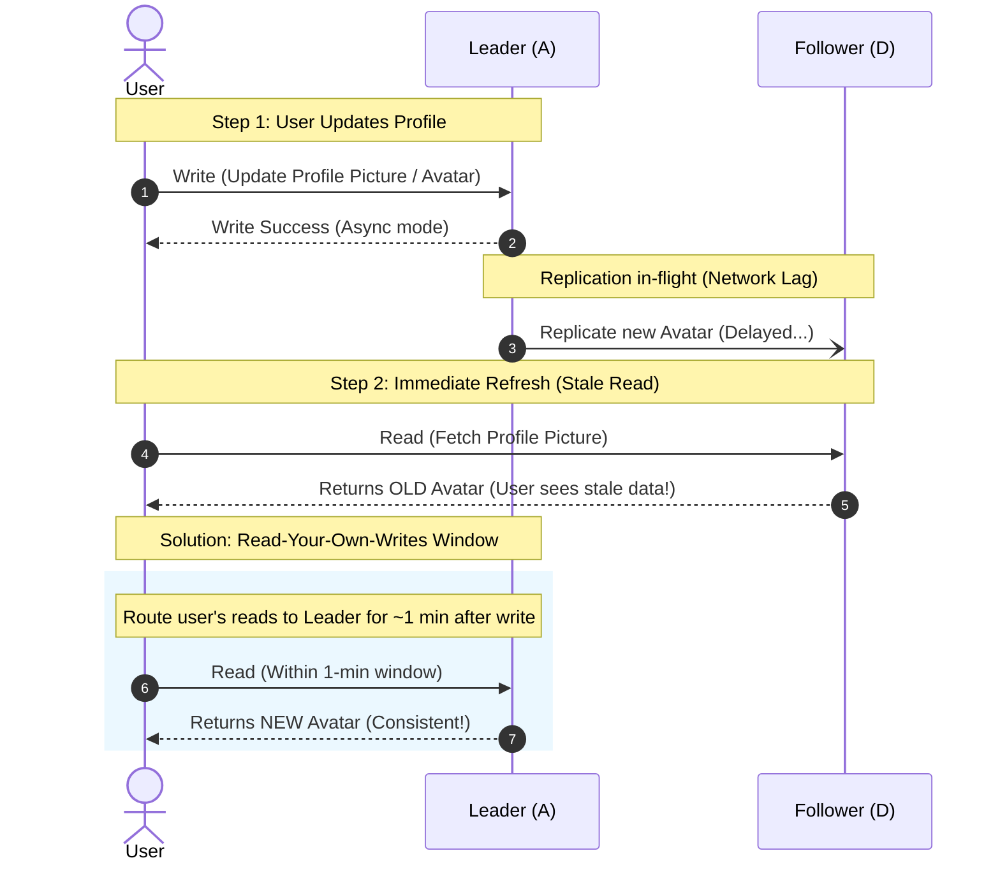
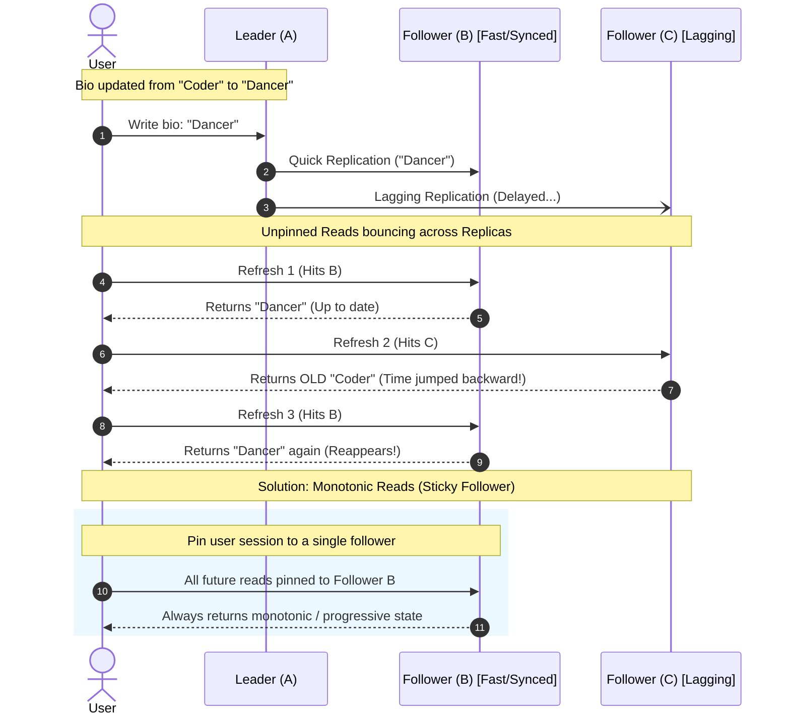
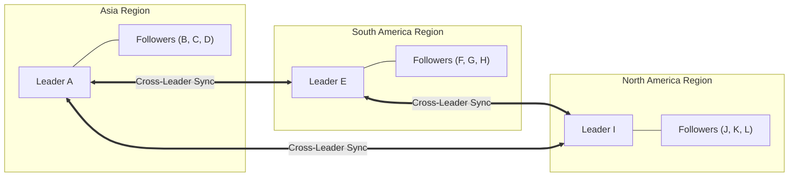
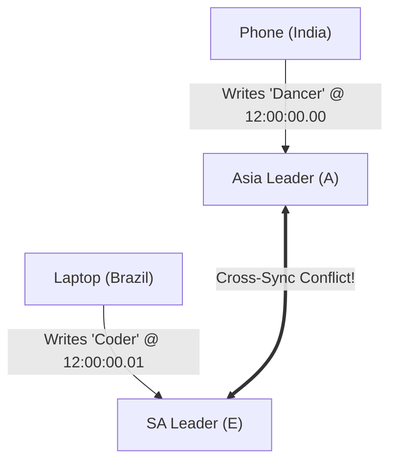
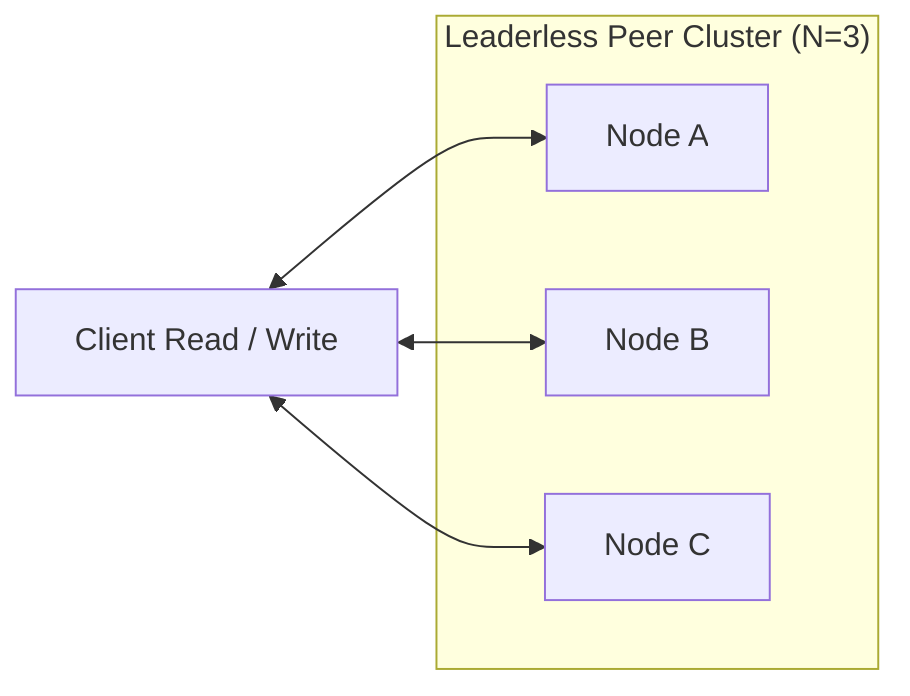
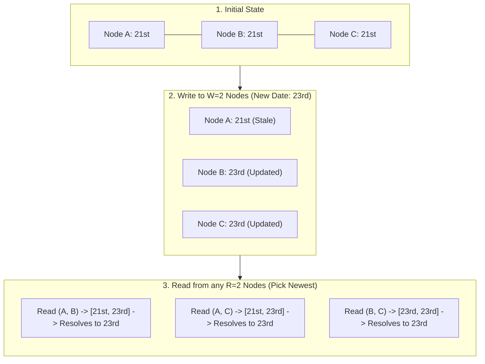

# System Design (HLD) Episode 8: Database Replication — What, Why & Algorithms

---

## 1. Real-World Symptoms of Replication Issues

When using distributed applications like Instagram or YouTube, you often encounter subtle and temporary glitches:

* **Profile Picture / Bio Reversion:** You update your **Instagram profile picture or bio**, refresh the page, and the **old picture/bio** reappears.
* **Vanishing Comments:** A new **comment** shows up $\rightarrow$ you refresh and it **disappears** $\rightarrow$ you refresh again and it **reappears**.
* **Jumping View Counts:** **YouTube view counts** jump around on successive refreshes: **500 views** $\rightarrow$ refresh $\rightarrow$ **700 views** $\rightarrow$ refresh $\rightarrow$ **500 or 400 views**.

> [!NOTE]
> All of these anomalies happen because of **Database Replication** and the inherent mechanics of how copies of data synchronize across multiple distributed servers.

---

## 2. What is Database Replication? (And Replication vs Sharding)

When data and traffic grow past the hardware limits (RAM/CPU) of a single machine (the vertical scaling limit), horizontal scaling across multiple database machines (e.g., **10 database servers**) becomes essential.

* **Database Replication:** Copying the **exact same complete dataset** across multiple database servers so every machine holds an identical copy.

### Replication vs Sharding (Do NOT Confuse Them)

| Feature | Replication | Sharding |
| :--- | :--- | :--- |
| **Core Idea** | **Copies** the full dataset across multiple machines. | **Splits** the dataset into smaller pieces (partitions) across machines. |
| **Attendance Register Analogy** | Both Computer 1 and Computer 2 store the **entire A–Z** student list. | Computer 1 stores names **A–P**; Computer 2 stores names **Q–Z**. |

---

### Why Do We Replicate Databases?

1. **Data Safety & Fault Tolerance:** If you have 3 database servers and 1 catches fire or suffers a disk failure, your data is not lost—the remaining replicas still hold full copies.
2. **Scaling Read-Heavy Workloads:** Many apps have far more reads than writes. For example, on Instagram, **90%** of users watch reels (**Read operations**) while only **10%** upload reels (**Write operations**). With 3 replicas, writes go to 1 machine while reads are served from the other 2 machines, preventing overload.

---

### The Core Challenge

If you have 3 (or 300) database replicas and a user creates an account or posts a reel (**Write**):
* Writing directly to all 300 databases synchronously on every request is **slow and impractical**.
* Writing to only 1 machine leaves the others with **stale (outdated) data**.

Different **replication algorithms** solve how writes propagate safely and efficiently across replicas.

---

## 3. Algorithm 1: Leader–Follower Replication (Master–Slave)

Formerly known as **Master–Slave** (e.g., in PostgreSQL), now commonly referred to as **Leader–Follower**.

### How It Works

Suppose you have 4 identical database nodes: `A`, `B`, `C`, and `D`.

* **Leader (`A`):** Designated as the single primary node. **All Write operations** (new signups, reel uploads, comments, likes) go **exclusively to the Leader**.
* **Followers (`B`, `C`, `D`):** Read-only replicas. Once Leader `A` writes new data (e.g., adding `Shreya` to a roster already containing `Raju`, `Aman`, and `Sanjeev`), `A` propagates that update to `B`, `C`, and `D`.
* **Reads:** Can be served from **any node** (Leader or Followers).
* **Why writes go only to the Leader:** Prevents **write conflicts**. If you update your bio to `"Coder"` on your phone (hitting `A`) and simultaneously update it to `"Dancer"` on your laptop (hitting `B`), two separate writers create conflicting states. Routing all writes through one Leader avoids this completely.
* **Interview Default:** Simple, conflict-free, and covers **~80% of system design interviews** unless specific global/availability constraints require otherwise.

---

### 3 Ways Leader Propagates Writes to Followers

| Mode | How It Works | Pros | Cons | Best Use Case |
| :--- | :--- | :--- | :--- | :--- |
| **Synchronous** | Leader `A` writes data, sends it to **all** followers (`B, C, D`), and waits until **every follower** confirms before completing the write. | **Strict consistency** & **zero data loss** (if `A` crashes, all followers already have the data). | **Slow**; **single follower failure blocks writes** (if `D` crashes, uploads stall even though 3 nodes are alive). | **Banking / critical payments** (e.g., transferring ₹5 Crore). |
| **Asynchronous** | Leader `A` writes data and **immediately confirms** success to the user, replicating to `B, C, D` afterward. | **Very fast** writes; unaffected if a follower goes down. | **Stale reads** temporarily; **data loss risk** if `A` crashes before replicating to any follower. | **Social media posts / likes / comments** (user can just re-post if lost). |
| **Semi-Synchronous** | Leader `A` writes data and waits for **at least 1 follower** (e.g., `B`) to confirm before succeeding; updates `C, D` asynchronously. | Fast like Async; safe against Leader `A` crashing (backup exists on `B`); doesn't stall if one follower dies (can pick `C`). | Slight latency overhead compared to pure Async. | General production apps needing both speed and durability. |

---

### 2 Common Problems in Leader–Follower Replication (and Solutions)

#### 1. Replication Lag (Read-Your-Own-Writes Issue)

* **The Problem:**
  * You update your profile picture (Write goes to Leader `A`).
  * You immediately refresh (Read hits Follower `D` before `A`'s async update arrives) $\rightarrow$ you still see your old picture.
* **The Solution:**
  * After a user performs a write, route all of that user's **reads directly to the Leader (`A`)** for a short window (e.g., **1 minute**).
  * Once followers catch up, resume reading from followers.

---

#### 2. Back in Time (Monotonic Read Violation)

* **The Problem:**
  * You change your bio from `"Coder"` to `"Dancer"` (Write hits `A`).
  * `A` updates Follower `B` quickly, while Followers `C` and `D` lag behind due to network delay:
    * **Refresh 1** hits `B` $\rightarrow$ you see `"Dancer"`.
    * **Refresh 2** hits `C` $\rightarrow$ you see old `"Coder"` *(looks like time went backward)*.
    * **Refresh 3** hits `B` $\rightarrow$ you see `"Dancer"` again.
  * *(This is the exact reason comments or YouTube view counts appear, vanish, and reappear on refreshes.)*
* **The Solution:**
  * Pin each user's read requests to **one consistent follower** (e.g., via sticky session / consistent hashing) so they never bounce between a caught-up replica and a lagging replica.
* **Practical Note:**
  * **Critical in Banking:** Seeing a ₹1,00,000 balance drop to ₹10,000 on refresh causes immediate panic.
  * **Acceptable in Social Media:** On apps like Instagram, likes fluctuating briefly between 90 and 100 on refresh is acceptable without extra engineering overhead.

---

## 4. Algorithm 2: Multi-Leader Replication

### Why It Exists

If a single Leader `A` is hosted in **Mumbai**, users in India experience **~1 ms** write latency, whereas users in the **USA** or **New Zealand** face high latency because every write must travel across continents to Mumbai.

### How It Works

* Deploy **multiple regional Leaders** across geographies—for example:
  * **Asia Region:** Leader `A` + Followers `B, C, D`
  * **South America Region:** Leader `E` + Followers `F, G, H`
  * **North America Region:** Leader `I` + Followers `J, K, L`
* Users write to their **nearest regional Leader** (like each country having its own Prime Minister).
* Each Leader updates its local followers **and** synchronizes changes with all other regional Leaders.

---

### Major Challenge: Write Conflicts

* **Scenario:** You update your bio to `"Dancer"` on your phone (routed to Asia Leader `A`) and at the exact same moment update it to `"Coder"` on your laptop (routed to South America Leader `E`). Both Leaders accept the write and broadcast conflicting values.
* **Conflict Resolution Strategies:**
  1. **Last-Write-Wins (Timestamp):** Keep whichever write has the later timestamp (e.g., `12:00:00.01` overrides `12:00:00.00`).
  2. **Manual / User Prompt:** Ask the user which version to keep (similar to **Google Docs** alerting *"A newer version already exists"* when editing across two browser tabs).
* **When to Use:** Only for **massive global apps** (like Instagram). Avoid for single-region systems (e.g., an India-only URL shortener) due to high conflict complexity.

---

## 5. Algorithm 3: Leaderless Replication (Quorum Systems)

### How It Works

There is **no Leader at all**—all nodes (`A`, `B`, `C`) are equal peers, and **any node can accept reads and writes**. Correctness is guaranteed through **majority voting (Quorum)**.

### The Quorum Rule

Let:
* $N$ = Total number of database replicas
* $W$ = Minimum number of replicas that must confirm a **Write**
* $R$ = Minimum number of replicas queried during a **Read** (returns the value with the **latest timestamp/version**)

$$\mathbf{W + R > N}$$

> [!IMPORTANT]
> Because $W + R > N$, the set of nodes written to and the set of nodes read from **must overlap by at least one node**. That overlapping node is guaranteed to hold the latest update.

---

### Exam Date Example ($N = 3$, $W = 2$, $R = 2$)

Here $W + R = 2 + 2 = 4$, which is **greater than** $N = 3$ ($4 > 3$).

1. Initially, 3 friends (`A`, `B`, `C`) all know the exam is on the **21st**.
2. The teacher announces the exam moved to the **23rd** (Write), reaching $W = 2$ nodes (`B` and `C`), while `A` misses it (still holds stale `21st`).
3. Whenever someone checks the exam date (Read), they ask any $R = 2$ nodes and pick the **newest answer**:
   * Ask `(A, B)` $\rightarrow$ `A` says `21st`, `B` says `23rd` $\rightarrow$ newest = **23rd**.
   * Ask `(A, C)` $\rightarrow$ `A` says `21st`, `C` says `23rd` $\rightarrow$ newest = **23rd**.
   * Ask `(B, C)` $\rightarrow$ both say `23rd` $\rightarrow$ **23rd**.
* Because $W + R > N$, the write group and read group **always overlap by at least 1 node**, guaranteeing the latest value is always found.

---

### Why Odd Numbers of Nodes ($N = 3, 5, \dots$) Are Used

* **The Even Node Problem ($N = 4$):**
  * With an even number like $N = 4$ (`A, B, C, D`), if $W = 2$ (`B, C` updated to `23rd`) and $R = 2$ (`A, D` still hold `21st`):
  * $W + R = 2 + 2 = 4$, which is **not** greater than $4$ ($4 \ngtr 4$).
  * Reading from `(A, D)` returns the wrong date (`21st`).
* **The Odd Node Solution ($N = 5$):**
  * Using an **odd $N$** like $N = 5$ (`A, B, C, D, E`) with $W = 3, R = 3$:
  * $W + R = 3 + 3 = 6 > 5$, ensuring strict majority overlap.
* **Drawbacks:** Complex to build and maintain; if multiple nodes go offline, writes/reads can fail to reach quorum thresholds. (Avoid in interviews unless specifically asked.)

---

## 6. Comparison of Replication Algorithms

| Algorithm | Who Handles Writes? | Who Handles Reads? | Write Conflicts? | Complexity | When to Use |
| :--- | :--- | :--- | :--- | :--- | :--- |
| **Leader–Follower** | Single Leader only | Leader or any Follower | **No** (single write authority) | **Low** (Default) | **80% of interviews**; standard single-region or moderate-scale apps. |
| **Multi-Leader** | Nearest Regional Leader | Local Leaders or Followers | **Yes** (requires conflict resolution) | **High** | Massive **global apps** needing low write latency across continents. |
| **Leaderless (Quorum)** | Any $W$ nodes ($W + R > N$) | Any $R$ nodes (picks newest version) | Possible (resolved via timestamps/quorum) | **Very High** | Specialized high-availability distributed stores when specifically required. |

---

## 7. Must Remember for Interview (From Video)

1. **Replication vs Sharding:** Replication **copies** the entire dataset across machines; Sharding **splits** data partitions across machines.
2. **Two core goals of replication:** **Fault tolerance** (surviving machine/disk crashes) and **read scaling** (handling read-heavy apps like Instagram where reads are ~90% and writes are ~10%).
3. **Leader–Follower (Master–Slave)** is the default choice: all writes go to the Leader, reads scale across Followers, and write conflicts are avoided.
4. **Replication Propagation Trade-offs:**
   * **Synchronous:** Safe, slow, stalls if any follower dies.
   * **Asynchronous:** Fast, risks stale data and data loss if Leader crashes.
   * **Semi-Synchronous:** Waits for 1 follower—balances speed and durability.
5. **Replication Lag:** (User doesn't see their own recent update) $\rightarrow$ Solved by routing a user's reads to the **Leader** for ~1 minute after they write.
6. **Back in Time:** (Seeing new data, then old data on refresh) $\rightarrow$ Solved by pinning a user's reads to a **single follower**—critical for banking, optional for social media likes.
7. **Multi-Leader:** Reduces global write latency via regional leaders, but introduces **write conflicts** (resolved via timestamps or asking the user, like Google Docs).
8. **Leaderless (Quorum):** Uses $W + R > N$ with an **odd number of nodes** ($N = 3$ or $5$) so reads and writes always overlap on at least one up-to-date node.

---

## 8. Quick Revision Table

| Concept | One-Line Summary |
| :--- | :--- |
| **Database Replication** | Copying the full dataset across multiple servers for fault tolerance and read scaling. |
| **Leader–Follower** | Default replication where 1 Leader handles all writes and replicates to read-serving Followers. |
| **Synchronous Replication** | Leader waits for all followers to confirm a write before succeeding (safe, slow). |
| **Asynchronous Replication** | Leader confirms writes immediately and updates followers in the background (fast, stale reads). |
| **Semi-Synchronous** | Leader waits for at least 1 follower to confirm before succeeding, then updates the rest async. |
| **Replication Lag** | Delay before followers receive a Leader's latest write, causing temporary stale reads. |
| **Back in Time** | Refreshing between a synced follower and a lagging follower makes updates appear and vanish. |
| **Multi-Leader** | Multiple regional leaders accept local writes and sync with each other (causes write conflicts). |
| **Leaderless (Quorum)** | Any node accepts reads/writes using majority overlap ($W + R > N$) on odd node counts. |

---

> [!TIP]
> ### Interview Tips (Mine, Not From the Video)
> 
> * Start with **Single-Leader + Semi-Synchronous replication** as your baseline in HLD interviews, and proactively state: *"To prevent users from missing their own updates right after a write, I'll route read-after-write traffic to the Leader for a short TTL window."*
> * If an interviewer pushes on **Multi-Leader conflict resolution**, mention **Last-Write-Wins (LWW)** for simple fields (like bios/settings) and **CRDTs (Conflict-Free Replicated Data Types)** or application-level merging for collaborative data (like shopping carts or shared docs).
