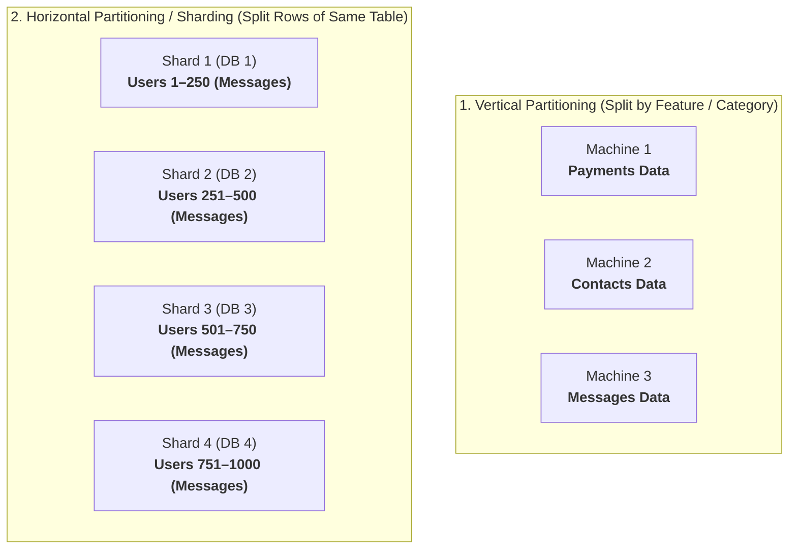
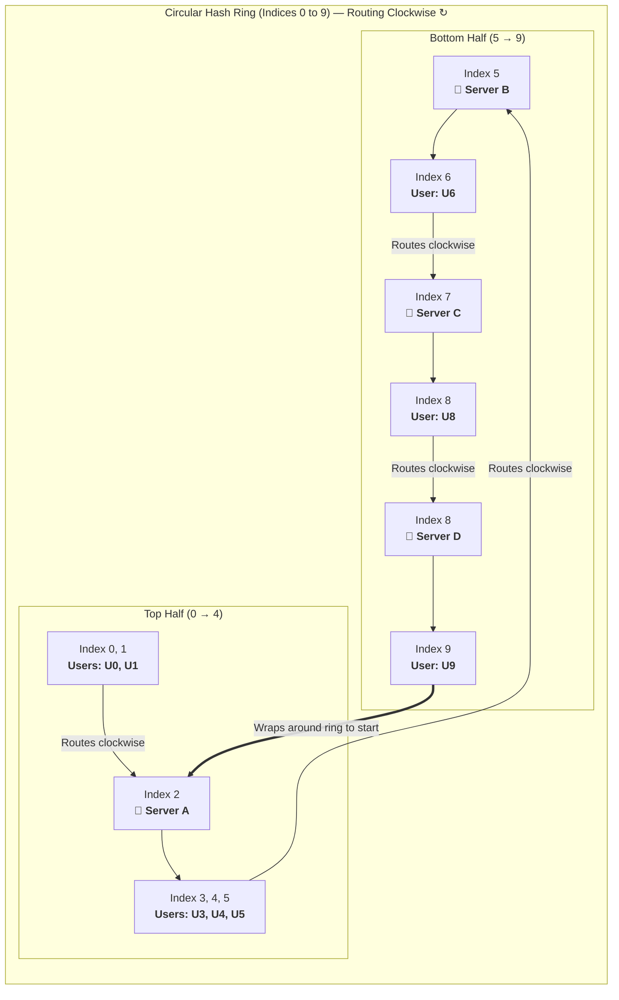
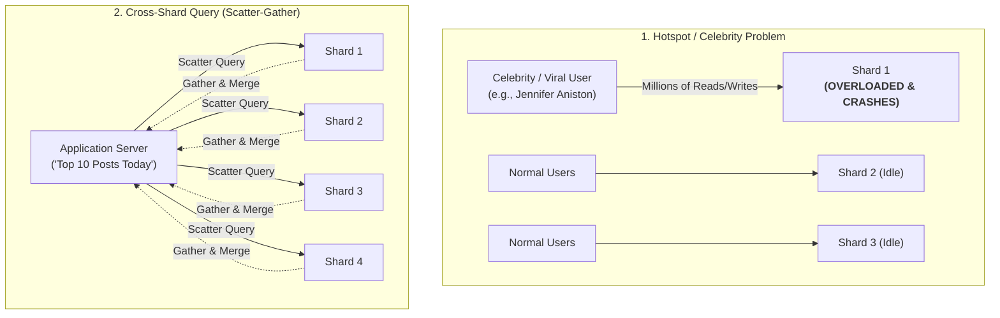
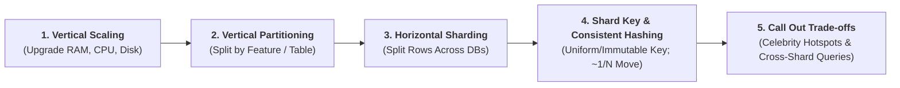

# System Design (HLD) Episode 9: Database Sharding & Consistent Hashing

---

## 1. Why Sharding Matters (and Why It Is a Last Resort)

> [!WARNING]
> **Golden Interview Rule:** **Sharding is a LAST RESORT**, never your first choice. Mentioning sharding right at the start of an interview just to sound advanced signals poor fundamentals—you must scale step-by-step and only introduce sharding when simpler methods hit their limits.

### The Scale Problem (WhatsApp Example)
* **At Launch:** WhatsApp launched with **3 users**; all user data fit comfortably on **1 machine**.
* **At Scale:** WhatsApp grew to **300 Crore (3 Billion) users**. Even with **Vertical Scaling** (upgrading RAM, CPU, and disk storage), no single machine on Earth can store 300 Crore users' data.

### What is Sharding?
**Sharding** is the process of breaking a massive dataset into smaller chunks (**shards / partitions**) and storing each chunk across separate database servers (e.g., splitting a **1 GB** dataset that cannot fit on one machine into five **200 MB** chunks across five machines).

---

## 2. Two Types of Sharding

### 1. Vertical Partitioning / Vertical Sharding (Start Here First)

* **How it works:** Split your database **by feature / data category** across separate servers.
* **WhatsApp Example:**
  * **Machine 1** $\rightarrow$ **Payments** data (WhatsApp Business)
  * **Machine 2** $\rightarrow$ **Contacts** data (~4,000–5,000 contacts per user)
  * **Machine 3** $\rightarrow$ **Messages** data
* **School Analogy:** When a small school opens with **10 students**, all ages sit in **1 classroom** (1 database). As admissions grow, the principal separates students by grade—**Class 1**, **Class 2**, ..., **Class 10** each get their own classroom.
* **Pros & Limits:**
  * **Pros:** Easy to set up and manage—stick with it as long as it works.
  * **Limit:** One category eventually grows without bound. For instance, WhatsApp **Messages** or Instagram **Posts/Reels** grow endlessly compared to profiles/contacts. In the school analogy: Class 10 has 40 students and fits in one room, but **Class 1 gets 1,000 admissions** and can no longer fit in a single classroom.

---

### 2. Horizontal Partitioning / Horizontal Sharding (True "Sharding")

* **How it works:** Split rows of the **same table / category** across multiple database servers (**shards**). For example, 10 users' messages live on Machine 1, the next 10 users' messages on Machine 2, and so on.
* **School Analogy:** Split the **1,000 students of Class 1** into **4 sections** (`1A`, `1B`, `1C`, `1D`), putting **250 students** into each section.
* **Query Routing Example:** On Instagram, Pratyush's data lives on **Shard 1 (Database 1)** while Ram's data lives on **Shard 2 (Database 2)**.

---

## 3. Choosing a Shard Key

A **Shard Key** is the column or attribute used to determine which shard stores a given record (e.g., using **Roll Number** `1–250` to place Class 1 students into Section `1A`).

> [!CAUTION]
> **Warning:** Once chosen in production, changing a shard key later is practically impossible without breaking and migrating the entire system.

### 2 Mandatory Properties of a Good Shard Key

| Mandatory Property | Good Shard Key | Bad Shard Key (Why It Fails) |
| :--- | :--- | :--- |
| **1. Uniform / Even Load Distribution** | **Roll Number (`1–1,000`):** Splits 1,000 students evenly into **250 per section** across 4 sections. | **Alphabetical First Name (`A–G`, `H–L`, `M–Q`, `R–Z`):** Many names start with `A`, `B`, `S`, while almost none start with `Q`, `X`, `Y`, `Z` $\rightarrow$ causes severe imbalance (e.g., **400** students in one shard vs **25** in another, or **700 / 200 / 49 / 1**). |
| **2. Immutability (Rarely/Never Changes)** | **Roll Number / User ID (`IN01`) / YouTube Channel ID:** Fixed for years. | **Name or Height:** • If Aditya (`A–G`, Section A) legally changes his name to Saurabh (`R–Z`), you must migrate his record to another shard. • Sharding by height (`< 4 ft` $\rightarrow$ A, `5–6 ft` $\rightarrow$ B, `6+ ft` $\rightarrow$ C) forces constant data migration as children grow. |

---

## 4. Shard Routing Algorithms

### 1. Range-Based Routing

* **How it works:** Assign contiguous ranges of the shard key to each shard (e.g., Roll Nos `1–250` $\rightarrow$ `1A`, `251–499` $\rightarrow$ `1B`, ..., `> 750` $\rightarrow$ `1D`).
* **Pros:** Simple to understand and implement.
* **Cons (Hotspot on the Last Shard):**
  * All new admissions / new users (`1001`, `1002`, ...) automatically append to the **last shard (`1D`)**.
  * Instead of distributing 4 new users evenly across `1A, 1B, 1C, 1D`, **`1D` gets overloaded** while `1A, 1B, 1C` sit idle.

---

### 2. Hash-Based Routing (Modulo Hashing)

* **How it works:** Apply a hash/modulo formula on the shard key:

$$\text{Shard ID} = \text{User ID} \pmod N$$

*(where $N$ is the total number of shards).*

* **Example ($N = 4$ machines: $M_0, M_1, M_2, M_3$):**
  * $U_0 \rightarrow 0 \pmod 4 = 0 \rightarrow M_0$
  * $U_1 \rightarrow 1 \pmod 4 = 1 \rightarrow M_1$
  * $U_2 \rightarrow 2 \pmod 4 = 2 \rightarrow M_2$
  * $U_3 \rightarrow 3 \pmod 4 = 3 \rightarrow M_3$
  * $U_4 \rightarrow 4 \pmod 4 = 0 \rightarrow M_0$
  * New users ($U_{10} \rightarrow M_2$, $U_{11} \rightarrow M_3$, $U_{12} \rightarrow M_0$) distribute evenly across all shards—**solving the Range-Based issue**.

#### Fatal Flaw: Massive Resharding on Scaling

> [!WARNING]
> When adding or removing a shard, almost all keys change their hash position:
> 
> * **Adding a machine ($N = 4 \rightarrow N = 5$):** Now every lookup uses $\text{User ID} \pmod 5$:
>   * $U_0, U_1, U_2, U_3$ stay on $M_0, M_1, M_2, M_3$ (**unchanged**).
>   * $U_4$ moves: $M_0 \rightarrow M_4$
>   * $U_5$ moves: $M_1 \rightarrow M_0$
>   * $U_6$ moves: $M_2 \rightarrow M_1$
>   * $U_7$ moves: $M_3 \rightarrow M_2$
>   * $U_8$ moves: $M_0 \rightarrow M_3$
>   * $U_9$ moves: $M_1 \rightarrow M_4$
>   * **6 out of 10 users = 60% of data must move!**
> * **When 1 shard crashes ($N = 4 \rightarrow N = 3$):** **60–70% of all users** (e.g., **70 Lakh out of 1 Crore users**) must be reshuffled across servers simultaneously, causing severe database thrashing and downtime.

---

### 3. Consistent Hashing (The Akamai Algorithm — Preferred Solution)

* **Historical Background:** Invented in **1997** by **Tom Leighton** and **Danny Lewin**, who built **Akamai** (a $4–5 billion CDN company) on this exact algorithm to solve server addition/removal reshuffling.

#### The Hash Ring Architecture

| Hash Index Range | Keys / Users Positioned | Routed Clockwise To | Why / Notes |
| :---: | :---: | :---: | :--- |
| **0 – 1** | `U0`, `U1` | 🎯 **Server `A`** (Index 2) | First server encountered moving clockwise (right) |
| **3 – 5** | `U3`, `U4`, `U5` | 🎯 **Server `B`** (Index 5) | First server encountered moving clockwise |
| **6** | `U6` | 🎯 **Server `C`** (Index 7) | First server encountered moving clockwise |
| **8** | `U8` | 🎯 **Server `D`** (Index 8) | Located at the exact server position |
| **9** | `U9` | 🎯 **Server `A`** (Index 2) | **Wraps around** the ring end (9 $\rightarrow$ 0) to hit `A` |

*Consistent Hashing ring: Each user key moves clockwise until hitting the first database server encountered.*

#### How It Works
1. **Define Hash Space:** Choose a large fixed hash space (e.g., $0$ to $1\text{ Billion}$; illustrated above with $0$ to $9$, size $10$).
2. **Place Servers:** Place all database servers (`A`, `B`, `C`, `D`) across this sorted circular space.
3. **Route Keys Clockwise:** Hash each `User ID` onto the space and **move clockwise / right** (via Binary Search) until hitting the **first server**:
   * `U0`, `U1` $\rightarrow$ move right $\rightarrow$ hit `A`
   * `U3`, `U4`, `U5` $\rightarrow$ move right $\rightarrow$ hit `B`
   * `U6` $\rightarrow$ move right $\rightarrow$ hit `C`
   * `U8` $\rightarrow$ move right $\rightarrow$ hit `D`
   * `U9` $\rightarrow$ nothing to the right $\rightarrow$ **wraps around** to the start $\rightarrow$ hits `A`

#### Why It Solves Resharding
* **When a Server Fails (e.g., `B` crashes):** Only the keys mapped to `B` (`U3, U4, U5`) shift forward to the next server `C`. Every other user (`U0, U1, U6, U8, U9`) remains completely untouched! Only $\approx \frac{1}{N}$ of data moves instead of $60–70\%$.
* **When a Server Is Added (e.g., `F` added between `A` and `B`):** Only keys in that small slice (`U3, U4`) shift to `F`; the rest of the ring stays intact.

---

## 5. Remaining Challenges After Sharding

### 1. Hotspot Problem / Celebrity Problem
* Even with Consistent Hashing, all data for a single User ID maps to **one specific shard**.
* **2019 Jennifer Aniston Instagram Crash:** When Jennifer Aniston joined Instagram in 2019, she gained **1 million followers in 6 hours**. Millions of requests for her profile and posts hammered the **single shard** storing her User ID, crashing it while other shards ran normally. *(Mitigated using Caching—covered in the next episode.)*

### 2. Cross-Shard Queries (Scatter-Gather)
* Queries requiring global aggregation—such as **"Top 10 Posts of Today"** on Instagram—cannot be answered by one shard.
* Because posts are scattered across machines (e.g., 2 viral posts on Shard 1, 3 on Shard 2, 4 on Shard 3, 1 on Shard 4), the system must query **all shards** and merge the results (**Scatter-Gather pattern**).

---

## 6. Interview Escalation Flow (Exact Order to Present)

*Step-by-step progression for introducing and defending database sharding in an HLD interview.*

---

## 7. Must Remember for Interview (From Video)

1. **Never lead with Sharding:** Treat Horizontal Sharding as a **last resort** after exhausting Vertical Scaling and Vertical Partitioning.
2. **Vertical vs Horizontal Sharding:** Vertical splits by **category/table** (Payments, Contacts, Messages); Horizontal splits **rows of the same table** across multiple machines (Class 1 split into `1A, 1B, 1C, 1D`).
3. **Shard Key rules:** Must provide **uniform distribution** (Roll Number/User ID, not first-letter alphabetical names) and be **immutable** (never changes like name or height).
4. **Range-Based vs Hash-Based:** Range-based routing overloads the **newest/last shard** with all new users; Modulo Hashing ($\text{User ID} \pmod N$) balances new users evenly.
5. **Why Modulo Hashing fails at scale:** Adding or removing a single shard changes $N$, forcing **60–70% of all user data** to migrate across servers.
6. **Consistent Hashing (Tom Leighton & Danny Lewin, Akamai, 1997):** Maps servers and hashed keys onto a circular ring; each key goes to the first server clockwise (wrapping around at the end). Adding or removing a server moves only $\approx \frac{1}{N}$ of the data.
7. **Always mention post-sharding trade-offs:** Proactively bring up the **Celebrity/Hotspot problem** (2019 Jennifer Aniston Instagram crash) and **Cross-shard queries** (fetching Top 10 posts across all shards).

---

## 8. Quick Revision Table

| Concept | One-Line Summary |
| :--- | :--- |
| **Database Sharding** | Splitting a large dataset into smaller partitions (shards) across multiple machines. |
| **Vertical Partitioning** | Splitting databases by feature/category (e.g., Payments, Contacts, Messages). |
| **Horizontal Sharding** | Splitting rows of a single large table across multiple database machines. |
| **Shard Key** | The uniform, immutable attribute (e.g., `user_id`) that determines which shard holds a record. |
| **Range-Based Routing** | Routes contiguous key ranges to shards; suffers from hotspots on the newest shard. |
| **Modulo Hashing** | Routes via $\text{key} \pmod N$; balances load evenly but reshuffles 60–70% of data when $N$ changes. |
| **Consistent Hashing** | Circular hash ring routing keys to the next clockwise server; only $\sim 1/N$ keys move on scaling. |
| **Hotspot / Celebrity Problem** | One viral user/key overwhelms the single shard assigned to it (e.g., Jennifer Aniston on Instagram). |
| **Cross-Shard Query** | Global queries (like "Top 10 Posts") that must scan and merge results from every shard. |

---

> [!TIP]
> ### Interview Tips (Bonus Points)
> 
> * **Virtual Nodes (vnodes):** When explaining **Consistent Hashing** in an interview, mention **Virtual Nodes (vnodes)** as a quick bonus point: instead of placing each physical server at just 1 spot on the ring, assign each server multiple points (vnodes) so load stays balanced even if servers have different hardware capacities or one server goes down.
> * **Key Salting / Compound Keys:** To solve the **Celebrity/Hotspot problem** at the database layer (besides caching), mention **key salting / compound keys**—for example, appending a random suffix (`celebrity_id#0` through `celebrity_id#9`) to spread a viral user's writes/reads across 10 shards instead of 1.
